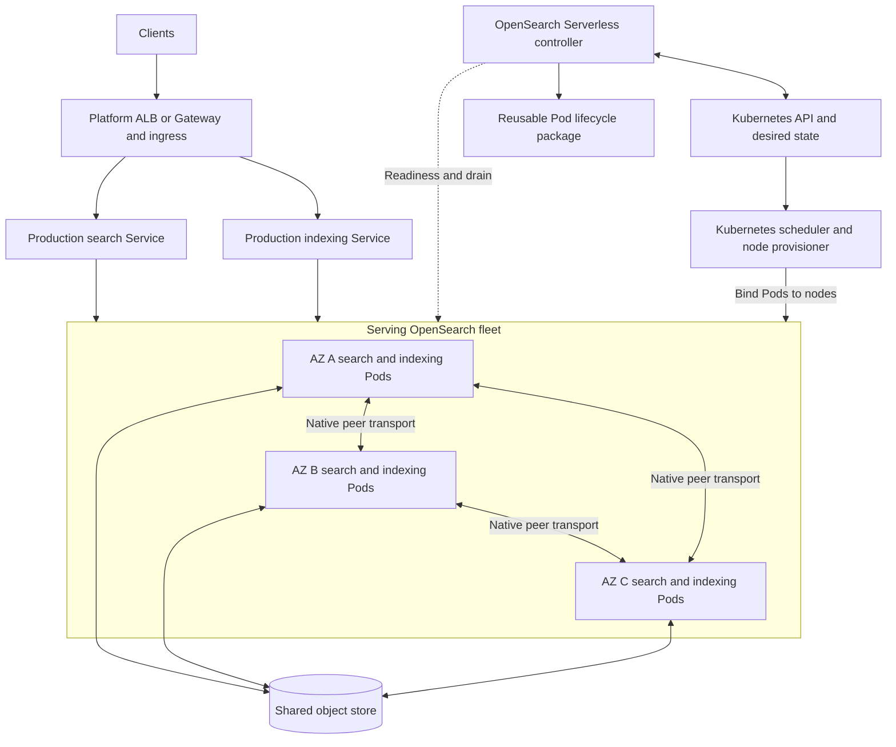

# OpenSearch Serverless Operator architecture

The operator runs the Java OpenSearch serverless shell as independently sized **indexing** and **search** fleets across availability zones. It controls Pod placement, traffic admission, and planned replacement. The Java shell controls peer membership, reader placement, writer ownership and recovery through a shared object store. Physical nodes remain under the Kubernetes platform's control.

This is the proposed operator design. It targets the published Java `feature/serverlessshell` revision `e71d42331a3ec82ec01109a5bb42d6a9a9162a5c`. The reference operator, CloudNativePG, Crunchy Postgres Operator, and autoscaler studies are linked from the research index. The pinned branch supplies a tested Java shell and process harness. Packaging a deployable image and qualifying the Kubernetes and cloud paths are implementation milestones. [Java revision](https://github.com/huyz0/OpenSearch/commit/e71d42331a3ec82ec01109a5bb42d6a9a9162a5c) · [Research and source snapshots](../research/README.md)

## System architecture

Stable client Services select search or indexing Pods from the serving fleet in all configured AZs. The optional preview Services use a separate fleet selector. Each Java process advertises its own peer address and zone in its object-store-backed lease. HTTP ingress and native peer forwarding therefore have separate paths and health signals. A request accepted by a search or indexing Pod can still be forwarded internally by Java. [Java assembly, ownership and API behavior](../research/java-serverless-architecture.md) · [Service and rollout contracts](traffic-and-security.md)

| Owner | State and actions |
| --- | --- |
| Operator | Owns namespaced Pod, Service, PDB, configuration and revision resources. Maintains per-role/AZ desired counts and floors. Collects Java eligibility, budgets scale and disruption, stages new fleets, approves traffic changes through explicit operations, and exposes status. |
| Reusable Pod lifecycle package | Computes safe next Pod actions from a caller's observations and policy. Executes scoped Kubernetes actions with identity checks. It can be imported without the OpenSearch API or Java client. |
| Java shell | Owns leases, peer routing, writer fencing and WAL replay, search readiness and cache warm-up, and graceful handoff. Durable metadata, WAL and segments live in the supplied store. |
| Platform | Owns nodes, node pools, autoscalers, ALB or Gateway, DNS, frontend TLS, tenant and network boundaries, and object-store provisioning. It may supply qualified node profiles and maintenance hints through namespaced resources. |
| Kubernetes | Schedules Pods, evaluates probes and readiness gates, publishes Service endpoints, and applies PDBs to Eviction API calls. |

## Workload and failure boundaries

- **Direct Pod control.** Make role and AZ explicit in each Pod's desired placement. Use the normal scheduler and track the exact Pod the operator is replacing. This supports waiting for a same-zone, application-eligible successor before retiring the selected predecessor. Native group-level rollout remains a fallback design if platform drain qualification exposes a blocker in direct ownership. [StatefulSet and PostgreSQL operator research](../research/multi-az-workload-research.md) · [Reference operator](../research/upstream-operator.md)
- **Zone-local counts and regional serving.** Pin each normal replica to its requested AZ. Maintain a separate serving floor per role and AZ and an overall floor per role. Allow healthy zones to serve requests when another zone is unavailable. Emergency replicas in surviving zones have their own bounded policy and advertise their actual zone. A single-AZ loss target depends on measured surviving capacity, ingress reachability and shared-store availability. [Placement and recovery](placement-and-recovery.md)
- **Optional one Pod per node.** A dedicated profile combines hard hostname anti-affinity, zone and profile selection, and platform taints. A warm spare is a real running replica. Node demand stays bounded even when a provisioner estimates that a Pod fits and Kubernetes finds otherwise. [Dedicated placement](placement-and-recovery.md#dedicated-node-profiles)
- **Durability and trust.** The platform pre-creates an exclusive bucket and grants the workload access for each independent instance. The instance can select its primary S3 remote store by repository reference. Compatible blue and green fleets share that bucket, which survives fleet and instance deletion. Provide HTTP and transport TLS inputs with controlled rotation and a trust overlap for CA rollover. [Primary S3 remote store](api-and-resources.md#primary-s3-remote-store) · [Traffic and security](traffic-and-security.md)
- **EKS and GKE Standard.** Use Karpenter NodePools on EKS and managed pools with GKE Cluster Autoscaler on GKE Standard. The Pod policy uses the same Kubernetes scheduling contract on both. GKE compute qualification and primary-store qualification are separate. The Java source supports `fs` and `s3` as primary stores, so direct native GCS support requires its own implementation and conformance testing. [Store implementations](../research/java-serverless-runtime.md#object-storage-and-credentials)

## Invariants to carry into implementation

1. An unready search Pod, timed-out warmup, missing lease, or unreachable peer never authorizes a planned retirement that requires that serving capacity. An explicit degraded-serving decision during recovery is visible separately from warm capacity.
2. An operator action must preserve applicable serving floors. In an existing shortfall it may restore capacity or complete a previously committed handoff when it can do so without causing another loss. Zonal PDBs gate ordinary eviction. A role-wide floor across independent PDBs requires coordination with the platform that initiates the drains. Infrastructure failures can exceed both bounds.
3. Only Java acquires, releases, fences or replays shard ownership. The controller observes those outcomes and retires processes with the supported Java hooks.
4. A controller retry uses verified owner identity, operation identity, and Pod UID. A restart or partially applied Service update is recoverable from persisted intent and observed resources.
5. Images, startup inputs, and TLS material delivered through Pod replacement are pinned to validated versions. In-place security changes use their own validated revisions. Normal Pod deletion and CR deletion preserve the supplied store and its user-owned credentials.
6. Search and indexing retain independent placement, sizing, warm reserves, routing and recovery measurements. A fault in one role can have client-visible effects in the other because Java shares a peer and storage plane.

## Detailed design

| Design | Decisions covered |
| --- | --- |
| [API and resources](api-and-resources.md) | Resource shapes, examples, validation, status, ownership, isolation, sidecars and permissions |
| [Runtime and cluster settings](runtime-configuration.md) | Common and per-role JVM options, startup settings, secure inputs, and explicit live cluster updates |
| [OpenSearch plugins from OCI registries](oci-plugins.md) | Artifact format, digest-pinned installation, role selection and rollback qualification |
| [Reconciliation and reusable Pod lifecycle](reconciliation.md) | Planner contract, durable operations, Pod identity, scale, drain, concurrency and deletion |
| [Placement, autoscaling and recovery](placement-and-recovery.md) | Role/AZ placement, AWS/GKE settings, fit calculation, warm spare capacity, provisioning limits and failure recovery |
| [Traffic, revisions and security](traffic-and-security.md) | Service inventory, ingress/ALB, blue/green and weighted traffic, Java readiness, TLS and credentials |
| [Dynamic security configuration](security-reload.md) | Live account management, provider capabilities, policy activation, fleet verification and revocation |
| [Delivery and validation](delivery-and-validation.md) | Implementation order, release gates, fault-injection scenarios, operational outcomes and open design decisions |

The design makes several choices for review. It uses a Go controller and library boundary, an explicit operation resource for traffic changes, and a stable fleet identity distinct from each immutable Pod template revision. Resource names, API group and field names in examples are proposals. [Proposed API](api-and-resources.md) · [Implementation decisions](delivery-and-validation.md#decisions-to-close-before-beta)
