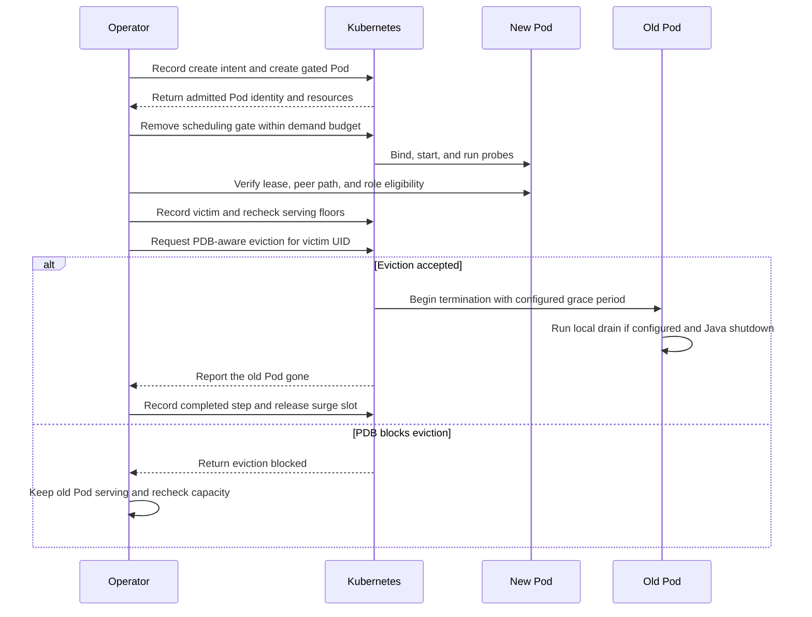

# Reconciliation and reusable Pod lifecycle

Implement a Go controller, with Kubernetes watches and work queues owned by the operator manager. Use Go's importable `pkg/podlifecycle` as the first reusable boundary. The library can later move to a separately versioned Go module when a second consumer needs independent release cadence. A Kubernetes Lease coordinates controller leadership. Instance actions still use persisted state and API preconditions so a restarted or replaced leader can recover safely. [Reusable package research](../research/pod-lifecycle-package.md) · [Go module layout](https://go.dev/doc/modules/layout) · [Kubernetes Leases](https://kubernetes.io/docs/concepts/architecture/leases/)

## Package boundaries

| Component | Responsibility |
| --- | --- |
| `api` and controller | Decode and validate desired state, reconcile owned inputs and Kubernetes resources, observe operations, write conditions and status, and choose when a disruptive transition is appropriate. |
| `pkg/podlifecycle` | Plan Pod creates, hold/release scheduling, retain, and retire steps from a workload-neutral snapshot. Provide guarded Kubernetes actions for the selected Pods. Accept ownership, placement-group identity and budgets as arguments. No Java or operator CRD dependency. |
| Java integration | Render the pinned launch contract. Observe startup, peer, lease, role and warm-up results. Invoke supported search drain or process shutdown and verify observed membership. Calculate eligibility for the operator. |
| Placement policy | Combine platform qualification, the admitted Pod, role/AZ requests and discovery of already-bound capacity. Optional provider observers enrich the same policy with launch and registration evidence. |
| Traffic and certificate policy | Resolve fleet identity and observed Service routes. Validate TLS inputs and stage immutable revisions. Use the same Pod lifecycle and availability budgets for rollouts and rotation. |

Keep the planner deterministic over observations and instrument it with reasons. Its inputs are an opaque group key, desired replica count, floor, surge limit, owner UID, Pod and attempt observations, an opaque template identity, and supplied eligibility and retire policy. Its output is a bounded action or a wait reason. An instruction to retire includes an exact Pod UID. It returns a need for application drain without calling OpenSearch. The Kubernetes executor checks the owner and target UID at execution time. The caller persists progress and owns the application side effects and operation-level atomicity. [Pod identity and owner references](https://kubernetes.io/docs/concepts/overview/working-with-objects/owners-dependents/) · [Deletion preconditions](https://kubernetes.io/docs/reference/kubernetes-api/definitions/delete-options-v1-meta/)

The Kubernetes adapter checks the controller reference and intent
annotation on both create responses and Pods recovered after a name
conflict. It removes a scheduling gate only while the Pod is unbound.

## Availability and resource accounting

Track distinct counts for desired, scheduled, Kubernetes Ready, Java-eligible, confirmed warm or takeover-capable, terminating, and provisionable unbound. Record the timestamp and process incarnation for Java observations. A Ready Pod with a stale or unverified lease is ineligible for a voluntary retirement decision. In a mixed fleet, count a Pod toward a role's client-serving floor only when its actual role Service admits it. Calculate Java peer health independently because all compatible fleet members can share the peer plane during blue/green.

Before starting a planned drain, remove from the projected serving count the chosen victim and other committed retirements that still appear eligible. Deduct each UID only once. Check the role/AZ floor, the fleet-wide role floor and the allowed number of concurrent retirements. Also account for resources consumed by terminating Pods, gated Pods that may reserve namespace quota, and pending nodes that may arrive later. The operator may restore capacity while existing availability is below target. It holds work that would reduce survivor capacity further.

Use a single PDB per Pod grouping, matched by instance UID, fleet, role and AZ. Integer `minAvailable` is supported for direct-managed Pods. A PDB uses Kubernetes readiness. For a strict warm-search floor, feed actual warm eligibility into Pod readiness. The operator separately enforces the role-wide and planned-operation floors, including on direct lifecycle actions. [PDB readiness and arbitrary workloads](https://kubernetes.io/docs/tasks/run-application/configure-pdb/#arbitrary-workloads-and-arbitrary-selectors)

Independent zonal PDBs can each admit an external eviction, even after losing a whole AZ. For example, two surviving zones with three search Pods each and a zonal floor of two can lose one Pod each through ordinary evictions. The search fleet then has four serving Pods against a role-wide floor of six. Kubernetes rejects overlapping PDB selectors, so a second role-wide PDB cannot compose with the zonal PDBs. The role-wide floor and concurrency limit apply to operator-controlled actions. For planned provider work that must respect the same role-wide limit, the platform must serialize drains and wait for the operator's capacity acknowledgement. During an outage the operator can tighten survivor PDBs as a best-effort hold on future evictions. Observe each PDB's generation and allowances before reporting the hold. An admitted eviction, forceful repair or provider deadline can still reduce capacity. [PDB selector restrictions](https://kubernetes.io/docs/tasks/run-application/configure-pdb/#arbitrary-workloads-and-arbitrary-selectors)

## Normal reconcile loop

Read the current instance, operation, owner-scoped resources and current health evidence. Reconciliation writes observed state back with the evaluated generation. The controller processes recovery before starting new disruptive work. Use watch-driven reconciles and bounded timers for sampling, readiness stability, cooldowns and operation deadlines. On ambiguous API errors, re-read before assuming a step failed.

The ConfigMap watch queues instances by same-namespace reference. The
index includes repository configuration, capacity profiles, outage and
retirement reports, and the plugin policies and snapshots referenced by
fleet pins or pending Pod intents. Each reconcile checks the live inputs
before it acts on a watch event.

The development Pod revision includes an operator-owned template version as
well as the instance spec and peer DNS mode. Changes to rendered fields that
are not captured in the spec must bump that version. A stale gate-release
intent is marked for withdrawal before the controller deletes the exact
still-gated, unbound Pod. It clears the intent after observing absence and
preserves release-rate history. An already removed gate is handled as an
observed prior effect only when the Pod UID, controller reference,
creation annotation, and workload labels match the recorded intent.
If a stale creation intent has an already-created Pod,
the development controller checks its owner, intent metadata, labels and gate,
then pins its observed UID in the withdrawal decision. An absent target is
recorded as a retired name before a new sequence is allocated; a later
matching, gated Pod is UID-pinned and withdrawn. Retired records remain
bounded at 64 with no automatic expiry, because delayed create latency has no
proven upper bound. The controller reads each recorded name directly and
holds a conflicting target, including one missing the expected instance
label. Initial adoption of an unpinned UID relies on namespace trust. This can
require up to 64 Pod GETs per reconciliation and does not automatically roll
existing Pods. A namespace-scoped, indexed Pod watch also enqueues an instance
when an unowned Pod appears under a retired name; watch delivery is eventually
consistent.

After gate release, the provisioning observer checks the Pod UID,
controller reference, and recorded role and AZ before it advances the
attempt or clears a group hold. A pending-timeout or outage withdrawal
also requires the exact observed resource version and an unbound Pod.
Each bound startup check has its own deadline, starting when the
controller first observes that the check is needed.

The development controller checks provably stale persisted intents before
resolving current TLS, storage and credential inputs. This permits guarded
retirement even if those new inputs are unavailable. It does not authorize a
new Pod or gate release without qualification. If the current peer domain
cannot be computed and generation and fleet still match, a revision-only
mismatch is unknown and ordinary validation holds.

The reusable Kubernetes executor provides `WithdrawGatedAtVersion` for a
caller that has already persisted withdrawal intent. It requires the observed
Pod UID, owner, resource version and named gate, and uses UID and version
preconditions on deletion. An API-server test confirms a concurrent gate
release makes the deletion conflict. The development controller uses it for
stale gate-release intents with a persisted decision and restart recovery.
Retired-name tracking handles matching late gated creates without claiming
that Kubernetes atomically fences Pod creation against instance status.

1. **Validate desired state.** Check roles, zones and floors, image and storage identity, resource compatibility, permissions and certificate revisions. Resolve startup settings and JVM options by role against the selected image. Stage immutable config and Secret snapshots. A validation failure retains previously admitted traffic where possible. [Runtime configuration](runtime-configuration.md#override-rules-and-rendering)
2. **Determine the traffic state.** Read each production Service and compare its observed selector with persisted serving intent. Resume a partial promotion before accepting another operation. During initial bootstrap, set each role to its initial fleet. Provide readiness before accepting traffic.
3. **Restore and qualify capacity.** Prioritize missing serving capacity over reserve or preview. Create Pods under recorded identities and admission gates where enabled, and wait for binding and application qualification. Count retries and in-flight demand by role and AZ. Bound emergency recovery with its own capacity limits.
4. **Advance one safe step.** Choose an action based on the active operation and verified floors. Persist the selected action and UIDs before invoking a side effect. Apply the action, observe its effect, and then advance its stage. Report blocked work with evidence and a retry policy instead of cycling Pods.
5. **Collect old owned inputs.** Remove immutable revisions and snapshots only when no running, queued or rollback-eligible Pod can need them. Keep bounded operation history. Preserve all external inputs and durable assets.

### Create, qualify, and replace one Pod

For the chosen role and AZ, use node profile and zone affinity to place the replacement. Eviction and drain begin only after the same group has eligible capacity for the projected change. Recheck immediately before external side effects, even if the candidate was healthy on the previous pass. Search drain is Java's reader handoff. Indexing retirement removes the terminating endpoint and gives the JVM time to quiesce and hand over its writers on `SIGTERM`. Java lease expiry and fencing handle an abrupt stop. [Java startup and termination](../research/java-serverless-runtime.md#startup-readiness-and-termination)

Request eviction before withdrawing the victim's Java search role or readiness. A concurrent provider eviction can consume the final allowance after the operator's preflight. If Kubernetes rejects the operator's eviction in that race, the victim stays serving. After eviction admission, use Java's local shutdown path, or a bounded local `preStop` when qualification calls for an explicit search drain. The application hook remains within the Pod grace period. A later loss of the replacement stops subsequent retirements and triggers recovery. Direct deletion is reserved for an explicit path such as withdrawing a verified unbound pending trigger. [Kubernetes API-initiated eviction](https://kubernetes.io/docs/concepts/scheduling-eviction/api-eviction/) · [Kubernetes termination hooks](https://kubernetes.io/docs/concepts/containers/container-lifecycle-hooks/)

Start an image or runtime change with a declared canary role and AZ. Verify the role's traffic and Java behavior before permitting the remaining waves. A requested pause holds new wave preparation or retirement at safe checkpoints. Re-evaluate current health upon resume, and give an already-started handoff an explicit recover-or-complete decision. Changes to available capacity or qualification can block the canary or later wave without changing the intended revision.

## Durable operations

Persist the operation identity, input snapshot, phase, child intent, selected identities, and verified postconditions. Use a monotonic phase progression while the operation remains within the same intent. A new spec can prepare inputs for later work. It must not silently retarget a stage that has already changed traffic or drained a Pod.

| Effect | Recovery rule |
| --- | --- |
| Create a Pod | Use an operation-specific deterministic name. On retry, read by name, verify the owning instance and intent, then accept the observed UID. A conflicting object blocks the operation. |
| Release a scheduling gate | Read the current UID and gate state. Re-evaluate qualification and budget before removing the operator's gate. Treat an already-removed gate as observed progress. Kubernetes permits adding scheduling gates only at creation. |
| Retire a Pod | Use UID preconditions on the eviction request. Leave application serving state intact until Kubernetes accepts the eviction. Treat a terminating Pod as committed. On an ambiguous response re-read the UID and deletion state, and apply the same budget before another attempt. The local Java drain is part of termination and needs no controller RPC replay. |
| Switch a Service | Record the intended role, expected selector and target fleet. Use an atomic conditional mutation of that Service that tests its UID and resource version or expected selector. Field ownership is a separate check. If one Service has changed, read both. Revalidate placement and health before each remaining mutation, and continue the recorded promotion or a rollback accepted within the same operation. |
| Apply live cluster settings | Serialize updates with rollout operations. Persist the qualified patch and read back affected keys after success or an ambiguous response. Record shared persistence separately from proof of effective behavior. [Live settings verification](runtime-configuration.md#live-cluster-settings) |
| Withdraw a failed scheduling request | Persist the blocked state, re-read the Pod, and delete only the owned unbound UID with resource-version preconditions. Reconciliation after restart respects the recorded pause. |
| Publish ready status | Use the status subresource and retry on conflict after reading current state. Record fresh evidence rather than reconstructing success from intent. |

Watch-driven updates are eventually consistent, and leadership does not make a controller action atomic with a cloud drain. PDBs and API preconditions are separate guards. Test stale informer reads, duplicate reconciles, concurrent node disruption and API timeouts after successful writes. [Scheduling gate semantics](https://kubernetes.io/docs/concepts/scheduling-eviction/pod-scheduling-readiness/) · [Resource versions and concurrency](https://kubernetes.io/docs/reference/using-api/api-concepts/#resource-versions)

## Scale, deletion, and re-creation

Normal scale-out adds Pods in explicit role/AZ groups. A scale-down drains the selected Pod after checking the remaining steady target including its reserve and required floor. Removing a zone reduces its group only after replacement capacity in the destination zones is observed when the new policy requires it. An autoscaler, if enabled, writes one delegated desired count per eligible pool or scale resource. It shares the same role/AZ floors and cannot bypass the operator's availability or provisioning limits.

The reusable `podlifecycle.PlanScaleDown` planner takes the current serving
fleet and role's zone policies. The caller includes the warm reserve in
each steady target and supplies an explicit zero target for an abandoned
zone. The planner waits for all zone targets, deducts terminating and
reserved Pods from projected serving capacity, and counts retirements
across the workload. Its proposal identifies one Pod by UID.
It selects a surplus Pod by zone, then Pod name and UID. For revision
replacement, rechecking a persisted claim evaluates that exact victim
against fresh capacity and budget observations, even if a new plan
would choose a different Pod.

The development search path applies the planner to strict-warm search
Pods in existing zones, including zones explicitly set to zero. It persists one retirement
intent and rechecks Java warm-up and lease, stable Service membership,
Pod versions, the instance generation, and the zonal PDB. The owned zonal
PDB must be the only budget selecting the victim. The controller bounds the
eviction request by the remaining lifetime of its qualification evidence.
It keeps the UID reserved until the terminating Pod disappears and allows
provisioning to restore capacity during termination. An explicit denial
triggers a delay when re-reading the victim confirms eviction has yet to
start. Kubernetes may mark a victim for eviction before recording the
deletion timestamp. The controller preserves the claim across that
transition. [Kubernetes eviction implementation](https://github.com/kubernetes/kubernetes/blob/v1.32.0/pkg/registry/core/pod/storage/eviction.go#L289-L340)

When a cold-bootstrap Pod is still serving, the controller can select its
recorded UID after a reduction. Every remaining replica and reserve target,
and the regional floor, must be met by strict-warm endpoints. The bootstrap
contributes no qualified capacity. A retained candidate or rollback fleet,
or an owned Pod reporting disruption, holds retirement.
Zone removal starts by retaining the search zone entry at zero. The controller keeps
its previous positive PDB floor while the destination is short and lowers
the floor only with fresh evidence of the destination's strict-warm
capacity and the budget UID and resource version observed during planning.
The controller re-reads the instance before each budget mutation. A new
operation claim or a changed budget version sends the decision back to
planning. The retired search zone entry remains in the spec for revision
continuity. Cleanup of unhealthy leftovers and deletion of the zone entry
need separate reconciliation.

### Index writer handoff evidence

The pinned Java runtime attempts writer publication and release on
`SIGTERM`, after it stops local activation and background work. The
writer admission overlay also waits for direct acquisitions and reopens
that the scheduler does not own. Shutdown
also releases hibernated writer heads. If handoff or lease release fails,
surviving writers recover through lease expiry and fencing. The search drain
endpoint leaves the ingest role in service. [Java shutdown](../research/java-serverless-runtime.md#startup-readiness-and-termination)

For a known test index, read `/_serverless/shards/<index>` before and after
retirement. It reads the durable shard head and reports the owner node ID
and term. Match the owner to direct Pod stats. Confirm a successful write
to the same shard at the newer term and read back every acknowledged test
document. Separately observe shutdown completion and the interruption
seen by the client. [Pinned catalog handler](https://github.com/huyz0/OpenSearch/blob/e71d42331a3ec82ec01109a5bb42d6a9a9162a5c/serverless/shell/src/main/java/org/opensearch/serverless/rest/CatalogHandler.java#L124)

An ingest Pod's readiness and lease qualify it as a serving endpoint.
The optional held-shard sample reports open local shards and can truncate
at 100 entries. A hibernated writer may still own a durable head after
its local shard closes. Automated retirement needs evidence for the
victim's full set of writer heads, admission and replay capacity on its
survivors, and recovery if shutdown is interrupted. [Pinned stats handler](https://github.com/huyz0/OpenSearch/blob/e71d42331a3ec82ec01109a5bb42d6a9a9162a5c/serverless/shell/src/main/java/org/opensearch/serverless/rest/StatsHandler.java#L627)

A Java writer retirement operation can supply this evidence by binding
an idempotency token to the victim JVM and stopping new writer acquisition
before taking the ownership inventory. Persist which heads were published
and released, and verify which survivor has opened each required writer
at a newer term. The controller can re-read those results after a restart
and keep the retirement slot until it can account for interrupted handoff.
A newer head term can be visible before the successor accepts writes, so
the write check remains separate from the head observation.

The Java successor endpoint verifies one exact independent shard on a
specific index JVM. It requires a foreground write that completed at a
strictly newer term, an open and unfenced local writer, a current JVM
lease, and a durable head naming that JVM at the same term. The check
does not activate shards or write probe documents. An idle shard may
remain pending until real traffic reaches it.
[Successor evidence contract](../implementation/java-runtime-build.md#observe-a-successor-write)

Save each successor observation against its immutable inventory entry.
Verify surviving index capacity, serving routing and the pinned store
when committing evidence. Record the complete outcome before clearing
the exact operation claim. A restart after the outcome can finish
cleanup from the journal without replaying eviction.

If deletion starts after eviction was armed, stop issuing eviction
requests and keep the claim. Read the recorded Pod name and compare the
UID until the original Pod is absent. A terminating Pod still counts as
present. After recording absence, continue receipt and successor
verification under the existing claim.

For a confirmed missing receipt, a successor can account for an
inventoried independent shard by accepting a write at a newer term and
showing that the physical head no longer carries predecessor WAL debt.
The original Pod UID must be absent before receipt readback. Persist
the observed receipt absence and the positive proof for each head.
For a partial receipt, retain coverage by inventory entry and apply the
same WAL requirement to each omitted head. Completion requires a
verified newer-term write for every head.
[WAL recovery evidence](../implementation/java-runtime-build.md#recover-a-writer-without-a-receipt)

An explicitly empty durable inventory can complete after a confirmed
missing receipt because there are no heads to transfer. The controller
still verifies a surviving index endpoint, the primary store and route
binding, the retired Pod's absence, and the current claim. Receipt
readback and new successor observations must remain within the lease
deadline through those checks.

The opt-in Java shutdown receipt persists the results observed by one
process under its node ID and ephemeral ID. The receipt can be read from
the store after that JVM exits. The authenticated Java endpoint can
serve this receipt through a survivor bound to the same instance and
store. It can be absent after an interrupted shutdown, and successor
write readiness needs independent evidence.
[Writer handoff receipts](../implementation/java-runtime-build.md#writer-handoff-results)

Receipt readback initially prefers the inventory observer and tries other
qualified index endpoints if that Pod cannot complete the read. Each
attempt has a three-second limit. At most four observers are tried per
pass, and the next position is saved in the operation journal. Only a
qualified response from a surviving observer can establish receipt
absence.

The authenticated durable inventory walks physical shard and bucket
registers, including heads absent from JVM-local state. Its pages have
no common snapshot timestamp. Close the exact target JVM's writer
admission before starting the inventory and keep a legacy node-ID-only
head as ambiguous evidence until it can be resolved.
[Durable writer head inventory](../implementation/java-runtime-build.md#durable-writer-head-inventory)

Record the complete physical inventory on the retirement operation with
the identity of the serving index JVM that read it. Require the victim
to stay admission-closed and the observer and pinned store to stay
current during the scan. Keep the operation claim when the scan fails or
returns ambiguous ownership. Refresh and reconcile the non-snapshot
inventory with current routing and capacity evidence before requesting
eviction. [Retirement head journal](../implementation/java-runtime-build.md#record-durable-ownership-before-eviction)

The initial inventory and the pre-eviction rescan use a journaled
observer position. An unavailable observer advances the position for the
next reconcile. A complete scan still runs within one JVM lease. The
controller keeps the operation on hold when the inventory exceeds the
journal limit or contains ambiguous ownership.

After eviction, read the receipt for the retired JVM through an
authenticated serving index JVM. Match each recorded independent shard
by index UUID, shard number and original term. Save the outcomes against
the existing inventory. Shared bucket heads and missing release results
keep the operation claimed for recovery. A release with WAL preserves
the need for successor replay and write evidence.
[Receipt journal](../implementation/java-runtime-build.md#record-the-writer-release-receipt)

The Java prepare operation closes admission for one JVM and operation ID.
Persist the matching Pod and JVM identity before dispatch and observe
`closed` for that operation before using the inventory. A timeout leaves
the reservation in place. The withdrawal phase changes client readiness
and preserves ingest membership for Java forwarding. Observe Kubernetes
and the serving proxy before closing writer admission. Require the live
Java peer cohort to observe withdrawal for the same incarnation. For a
selector-based Envoy index route, bind signed proxy evidence to the pinned
HTTPS listener, stable Service and current frontend replica and backend
EndpointSlice versions. Check active routes and EDS on every serving
replica. Check the victim reservation again before the POST. Pass the
earliest evidence deadline to Java so a queued request cannot close
admission after its evidence expires.
[Prepare writer retirement](../implementation/java-runtime-build.md#prepare-writer-retirement)

Before dispatching writer eviction, check the zonal PDB, then recheck the
qualified Java cohort, index Service and EndpointSlices, Envoy route and
frontend, signed report, credential version, and operation claim. The
eviction uses the observed victim UID and resource version and the
existing evidence deadlines.

During preparation a hibernated writer can still reopen the exact durable
head it already owns, at the same term and within local capacity. Shutdown
closes that path and waits for admitted wakes before releasing the head.
The successor's newer-term write remains a separate check.
[Hibernated writer handoff](../implementation/java-runtime-build.md#hand-off-hibernated-writers)

Use an explicit `Decommission` operation while the instance still exists for ordered shutdown. Stop new work, withdraw eligible unbound children, and retire owned serving fleets within the operation's wave budget. This intent authorizes retiring the instance's own PDB constraints for a whole-fleet stop. Verify each owned child, report any blocked cleanup, then allow the instance to be deleted. On a direct CR deletion, cleanup using a finalizer is best effort. Foreground garbage collection can delete dependents before an operator finalizer completes, and namespace teardown can remove the objects the operator needs. Preserve the supplied bucket, externally managed TLS and workload identity objects in both paths. Reattachment under a new CR UID is a separate recovery procedure after reconciling old processes and leases and confirming exclusive bucket use. [Kubernetes foreground collection](https://kubernetes.io/docs/concepts/architecture/garbage-collection/#foreground-cascading-deletion) · [Kubernetes finalizers](https://kubernetes.io/docs/concepts/overview/working-with-objects/finalizers/) · [Java durability and recovery](../research/java-serverless-architecture.md#write-acknowledgement-publication-and-recovery)
