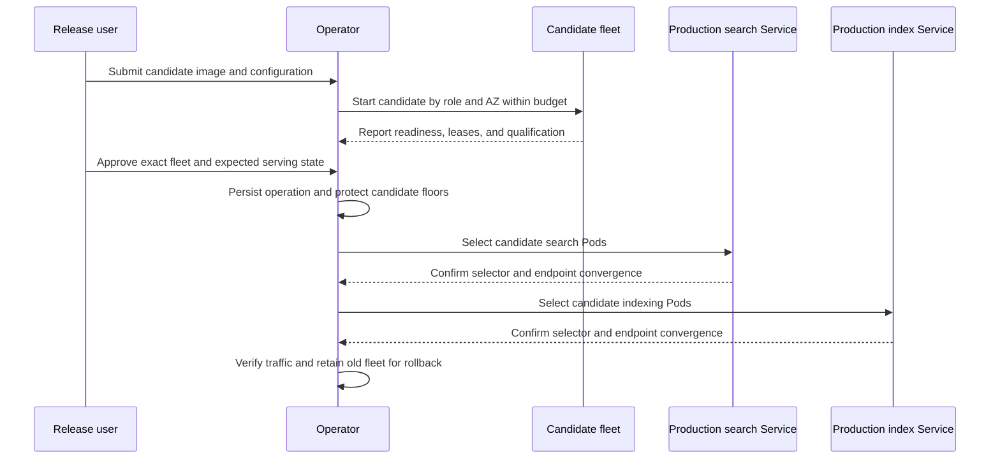

# Traffic, revisions, and security

For an explicitly qualified development image, the controller can
record a historical candidate-ingest lease observation for the allocated
role/AZ Pod set. This observation is not a promotion gate: it does not prove
write success, shard takeover, actual AZ placement or peer compatibility.
When endpoint observation is enabled, a separate result also reports whether
the pinned preview Service's EndpointSlices contained the sampled candidate
Pod set at the time of observation. It does not prove a client request path.
The equivalent development search sample requires strict warm-up completion
and can also report preview endpoint coverage; it remains historical rather
than promotion authorization.

The development EndpointSlice observer re-reads the UID and resource version
of each counted Ready backend and re-lists the selected slices before
returning its observation. A changed Pod or slice invalidates that sample.
Each counted Pod must be released for scheduling, use the Pod network, and
have one true Ready condition. IPv4 and IPv6 endpoints for a single Pod
count once. A backend address claimed by multiple Pod UIDs invalidates the
observation. The reads happen independently, so the sample describes
endpoint coverage during the observation window.

Expose a stable HTTP endpoint per role and keep native peer addresses on the Java lease path. The operator supplies the role Services, readiness, and any preview Services. The platform maps ingress or Gateway routes to those Services and operates the external load balancer. Health-qualified fleet labels control which Pods receive client traffic. Java still chooses the peers that execute requests. [Java membership and network contract](../research/java-serverless-runtime.md#membership-and-network)

## Service inventory and routing

| Service | Number for an instance | Selection and use |
| --- | ---: | --- |
| Production search and index | 2 | Stable Service names and ports. Select instance UID, role and serving fleet across all enabled AZs. |
| Preview search and index | Up to 2 | Optional internal endpoints for the candidate fleet during qualification. Restrict external exposure and direct writes. |
| Per-fleet endpoints for weighted mode | 2 per participating fleet | Optional stable backends for a gateway that splits traffic between fleets. Keep a backend for each role so the route weights can be managed independently. |

The operator verifies that these Services use internal ClusterIP routing.
An added external IP or NodePort blocks route qualification until the Service
matches its managed shape. The platform exposes clients through the edge
route and load balancer.

An ingress can map `search.example.com` to the search Service and `index.example.com` to the indexing Service. Separate hosts are easy to reason about when search requests can use `POST` and route paths overlap. If a gateway classifies requests within one host, explicitly qualify its path, method, auth and retry rules. The HTTP role boundary controls routing and workload isolation. Enforce authorization in the chosen gateway and Java integration. Run transport packets directly between native peer addresses. Do not publish a shared load-balanced address in the Java lease. Permit only expected peers, readiness callers and admin clients to access their respective ports and endpoints. [Java role and native transport evidence](../research/java-serverless-runtime.md#membership-and-network)

The example routes an instance named `catalog`. Apply the Ingress in the
instance namespace and set its class and hosts to the platform values. The
platform owns the Ingress and its TLS and authentication configuration.
During promotion the backend names stay fixed while the operator switches
the fleet selectors on the two Services. [Role Ingress example](../../config/dev/role-ingress.example.yaml)

## Ingress and ALB

For an ALB in front of a separate ingress proxy on EKS, use two health boundaries. Register ingress Pod IPs where supported. Spread the ingress replicas across AZs and keep target-group cross-zone routing enabled. Configure a fast health path on the ingress Pod itself. Validate its HTTP status and actual health-check Host handling. A backend role outage should be visible through the affected route. End-to-end probes should test both routes from a client vantage point. ALB can fail open when all targets are unhealthy, so a health path should avoid ejecting every ingress Pod because one role or shared dependency has a fault. [ALB health and fail-open](https://docs.aws.amazon.com/elasticloadbalancing/latest/application/target-group-health-checks.html) · [ALB cross-zone behavior](https://docs.aws.amazon.com/elasticloadbalancing/latest/application/edit-target-group-attributes.html#cross-zone-load-balancing)

At ingress, send requests only to Ready endpoints of the appropriate role Service. Leave `publishNotReadyAddresses` disabled on client Services. Ensure traffic can fall back across zones when one zone has no eligible endpoints. Passive upstream ejection and a bounded retry can help replay-safe searches during an abrupt failure where the ingress supports them. An indexing timeout can leave an unknown write outcome. A client retries writes only using an application-level contract that makes the replay safe. [EndpointSlice readiness](https://kubernetes.io/docs/reference/kubernetes-api/discovery/endpoint-slice-v1/) · [Service routing](https://kubernetes.io/docs/reference/networking/virtual-ips/#traffic-distribution-control)

Measure ingress target ejection and Java endpoint ejection separately. A
healthy ingress process may still select a failed Java address while its
endpoint view converges. Compare per-role transport timeouts and HTTP
statuses against the timestamps at which each layer withdrew its target.
For ALB IP targets, AWS documents a minimum health check interval of five
seconds, timeout of two seconds, and unhealthy threshold of two consecutive
failures. Use the configured values to design the drill and measure the
actual per-target convergence time. [ALB health check settings](https://docs.aws.amazon.com/elasticloadbalancing/latest/application/target-group-health-checks.html#health-check-settings)

The Envoy Gateway development example attaches active HTTP checks to the
two role routes. The Gateway discovers eligible Pods through the stable
Services. The policy selects Endpoint routing explicitly so a shared
Gateway's Service routing default cannot reduce the check to the Service
IP. The proxy checks each discovered address directly. A successful check
cannot add a Pod outside the Service's EndpointSlices or substitute for
strict warm readiness. Disable Envoy panic routing for these routes so
an empty healthy set returns unavailable instead of restoring failed
addresses. The platform owns the Gateway, routes and health policy. Check
the backend path against the runtime's TLS and authorization contract
before using it with a protected listener. [Role Gateway example](../../config/dev/role-gateway.example.yaml) · [Envoy Gateway health policy fields](https://gateway.envoyproxy.io/docs/api/extension_types/#healthcheck)

Target Pods must report the same JVM incarnation in direct readiness
and stats checks before they can qualify for a selector switch.
Promotion also checks that the retained source Pods report a usable
incarnation and lease before issuing a new selector write.
Both rollout modes bind platform qualification to the signed report's
ConfigMap UID and resource version. A changed report requires a fresh
observation.
The operator checks the evidence age again after the final Service or
HTTPRoute read and before it submits a conditional traffic patch. If any
required evidence expires during that read, the operation waits for a
fresh observation.
After the switch, development promotion and rollback
require a fresh HTTPS response through the configured role route. The
response must report a live lease and the same JVM incarnation as direct
qualification for the responding Pod UID. The Pod and Service versions
must still match the current EndpointSlice observation. Keep the stats
path uncached at the Gateway. A 503, an old JVM under a reused Pod name
or a runtime without the incarnation field leaves the route unconfirmed.
The observation covers the proxy and backend that handled that request.
Before advancing indexing or committing the fleet, the executor rechecks
both roles' qualified Pod sets and the EndpointSlice identities and
versions used by each applied route. It repeats the Service reads after
the budget and source checks. A changed Pod invalidates its qualification
and route evidence. A changed EndpointSlice invalidates convergence for
that role. The planner also checks the earliest sampled lease deadline
against decision time, including the pinned shell's clock-skew cutoff.
The next reconciliation collects new evidence. These reads
bound the race with Kubernetes changes. The objects can still change
between reads or after the check.

Before planned ingress replacement, wait for the new ingress Pod to become healthy in the ALB target group. AWS Load Balancer Controller injects its target-health readiness gate at Pod creation when the namespace, matching Service and IP TargetGroupBinding are present. For direct ALB targets, the registered targets are Java Pods. Use an ALB health endpoint that checks the intended Java eligibility itself. The controller can register a Pod with containers ready even while a Kubernetes readiness gate still holds the Pod unready. ALB fail-open remains a separate case. Align connection draining and termination grace. Health detection and propagation take time after a hard failure. Qualify response codes and timeouts and distinguish ALB 5xx from target 5xx. [AWS Pod readiness gate](https://kubernetes-sigs.github.io/aws-load-balancer-controller/latest/deploy/pod_readiness_gate/) · [AWS controller IP endpoint resolution](https://github.com/kubernetes-sigs/aws-load-balancer-controller/blob/v3.6.3/pkg/backend/endpoint_resolver.go#L153-L187) · [ALB failure tests](../research/node-disruption-recovery.md#route-around-failed-endpoints-behind-an-alb)

## Readiness and shutdown

| Signal | Use |
| --- | --- |
| Process and startup checks | Use the shell's health and startup milestones to distinguish JVM start, configuration errors and process failure. Keep the liveness decision independent of a temporary shared-store outage. |
| Local lease and peer reachability | Check `lease.valid_now` and the requested role in local stats. Verify the independently advertised peer lease, zone, process incarnation and peer address using authenticated runtime or platform evidence. Local role presence alone does not prove peer reachability. Qualify that another Pod can reach the advertised transport address. |
| Search app readiness | Java can report ready after timeout, failed copy, or search warm-up disabled. For a strict maintenance PDB, make the kubelet's container readiness probe check measured warm eligibility on the current Java process. Use an operator-managed Pod condition for supplemental checks only. The kubelet can retain that custom condition across a container restart. |
| Indexing app readiness | Require a valid ingest lease and measured ability to accept writes and shard takeover. Use synthetic write and replay checks in qualification. A fresh Pod is not preassigned the old writer's shards. |
| Graceful shutdown | Let `SIGTERM` reach Java after Kubernetes admits eviction for a planned retirement. If used, a bounded local `preStop` performs the authenticated search drain during termination. Keep sidecars required by Java available until Java exits and qualify the total grace period against provider deadlines. |

The development Java bundle reports lease validity and expiry from the same
successful local publication. The readiness probe still requires a positive
lease margin and the expected role. [Local lease observation](../implementation/java-runtime-build.md#local-lease-observation)

Expose warmup status directly on the replacement with process identity, initial readiness outcome, selected hot blocks, locally held blocks, peer responses and shard-open results. Separately report when the background copy actually stops. Record timeouts and failures separately from verified later warmth. Treat the process identity change as invalidating all previous samples. Existing hit/miss counters measure cache and object-store behavior. A request sent to the Pod could be served by another peer. Kubernetes readiness applies to Service endpoints and PDB counting. It does not change Java's advertised search role, which can become eligible for peer reads after a warm-up timeout. Strict warm admission for native readers would require Java routing changes. During all-cold recovery, an explicit degraded-serving policy may make cold Pods Kubernetes Ready. They then count toward the PDB. Report the warm deficit separately and keep operator-controlled maintenance on hold. [Kubelet custom condition handling](https://github.com/kubernetes/kubernetes/blob/v1.36.0/pkg/kubelet/kubelet_pods.go#L1955-L1991) · [Java role advertisement](https://github.com/huyz0/OpenSearch/blob/e71d42331a3ec82ec01109a5bb42d6a9a9162a5c/serverless/shell/src/main/java/org/opensearch/serverless/node/SearchReadiness.java#L100-L136) · [Warm-up gate research](../research/node-disruption-recovery.md#verify-that-a-search-pod-is-warm)

The experimental Java overlay adds an opt-in process-local completion gate for
both local search and lease role advertisement. It requires warm-on-join and
keeps degraded or timed-out search nodes out of those paths. A completed
worker is still not proof of current cache residency. The development controller
requires `coldStartPolicy: AllowOneDegraded` for this mode and reserves one
bootstrap Pod by durable identity; that Pod can serve cold and counts toward
its PDB. Subsequent Pods use the completion gate. If the bootstrap Pod
disappears while a search Pod in the serving fleet is Ready, the replacement
still uses the completion gate. The fallback is restricted to a fleet
without a recorded bootstrap or a Ready search Pod. Baseline Java behavior
remains the default.

## Blue/green promotion and rollback

Use a shared-store candidate fleet only after the image pair passes bidirectional peer compatibility and storage format qualification. Java starts using a candidate's compatible peers before a Service switch. Preview proves which fleet accepted a client request. Evidence about execution has to identify the actual peer. A fully isolated cutover would require an explicit runtime cohort boundary or a data replication and write-fencing design for separate stores. [Blue/green research](../research/blue-green-deployment.md)

Stage the candidate in bounded waves and count all active, retained, candidate and terminating Pods against qualified capacity. A full preview can require roughly twice the steady fleet. Before promotion, check every required candidate role/AZ, membership, health and route. Pre-apply the candidate's serving PDB floors, verify them and keep the original fleet available. Keep one PDB per stable fleet, role and AZ group. Candidate and retained groups have their own retention floors, which can be lowered explicitly on retirement. The initial blue/green policy admits at most two full fleets. A new candidate waits for the existing candidate or rollback fleet to retire.

The current development API accepts `spec.rollout.candidate.fleet` and a
digest-pinned `image` when the strategy is `BlueGreen`. Reconciliation records
the candidate identity and creates the two candidate preview Services. The
opt-in development Pod path can stage a bounded candidate using the same
image as the serving fleet; different-image compatibility remains unqualified.
Until candidate
retirement is implemented, removing the request withdraws unbound candidate
Pods through persisted, identity-guarded paths. Once no candidate Pods or
preview Services remain and lifecycle work is settled, the active candidate
record becomes a retained fleet identity; a later candidate must use a new fleet
name. The retained history is capped and currently has no garbage collection.
Preview Service retirement is recorded and their deletion uses UID and
resource-version preconditions; this does not prove traffic has drained. A Pod
that binds first remains under bound-Pod monitoring.
Changing the candidate template leaves the candidate held. Restoring an
unchanged candidate template can recover the recorded identity after pending
lifecycle work settles. Configure network access separately; ClusterIP alone is not an
authorization boundary.

Replica counts, warm spare counts and minimum serving counts within
existing zones leave the Pod template revision stable. Newly staged
fleets use the scale-independent revision. Existing roles with surviving
Pods keep their verified revision label for new Pods. Zone membership
and runtime inputs still affect the revision.

When upgrading a fleet created by the count-dependent controller, wait
for `status.templateRevisionAliases` to record its existing label before
changing its capacity. The upgrade can recover hashes it can reproduce
from the current spec and previously verified aliases. A role already
mixed across unrecoverable older hashes still holds rollout qualification.
Restore one verified serving revision with capacity-preserving replacement
before promoting.

The controller records the literal serving revision per role and fleet in
`status.servingRevisionByRole`. A homogeneous cohort with a bound Ready
Pod can establish the pin during reconciliation. Gated first attempts do
not establish it. Selector and weighted rollouts persist both role pins
with the serving mapping, and rollback restores the retained labels.
After total Pod loss, a recorded compatible pin supplies the replacement
label. An older instance that loses every Pod before the controller records
its serving revision may recover with the canonical label.

With a stable ingress proxy, the initial promotion changes the search Service and then the indexing Service. Each change is independent, so mixed traffic can occur during promotion or after restart. Read back both selectors and recheck eligibility before each conditional update. Verify EndpointSlice convergence and use a bounded probe through each production route to identify the fleet that accepted the request. The receiving fleet and the actual Java execution peer can differ. Treat missing route evidence as unknown rather than claiming completion. Keep the old fleet healthy through the chosen rollback window and connection drain.

If a role fails qualification mid-promotion, hold the remaining changes. An authorized rollback of the active operation restores only roles that switched, with the expected per-role mapping and conditional updates. Require the current security revision, viable TLS, serving capacity, and compatibility with formats the promoted image could have written. Hold mixed routing and report degradation when neither direction is safe. Routing rollback preserves writes submitted after promotion. Retiring a fleet is a separate bounded lifecycle operation after retention. [Kubernetes EndpointSlices](https://kubernetes.io/docs/concepts/services-networking/endpoint-slices/) · [Blue/green compatibility evidence](../research/blue-green-deployment.md#promotion-and-rollback) · [Security activation](security-reload.md#apply-a-security-revision)

The role Service and HTTPS edge probes require a bound, Ready Pod with no
placement gate, deletion timestamp, or active disruption condition. A reply
from a Pod marked `DisruptionTarget=True` cannot confirm convergence while
the Pod still occupies its placement slot.

### Managed HTTPS and Basic Auth

The development blue/green path supports managed Pod HTTPS with or
without `ServerlessBasicAuth`. For Basic Auth, configure
`--development-rollout-search-auth-secret` and
`--development-rollout-ingest-auth-secret` with Secret names in the
instance namespace. Use immutable `serverless.opensearch.org/rollout-probe`
Secrets containing `username` and `password` for ordinary application
accounts. The two role routes may use the same account. Use separate
credentials from the bootstrap account.

The Gateway terminates client TLS and uses a `BackendTLSPolicy` to
validate HTTPS to each role Service against the backend CA and a name in
the runtime certificate. Configure the operator with the two frontend
HTTPS URLs and their CA. The frontend and backend can use different
certificate identities and trust roots. The protected backend authenticates
the forwarded client request. The plaintext active health-check example
in `config/dev/role-gateway.example.yaml` expects HTTP 200 without a
credential. For this development path, route using ready EndpointSlices.

The operator checks both target roles directly before changing selectors.
Each qualified JVM must accept the corresponding route credential and
report the expected identity and lease. Immediately before an effect,
revalidation checks the credential Secret identities and Pod observations.
After each selector change, the public-facing route must reject anonymous
stats requests and identify a qualified JVM when called with the ordinary
credential. Only then does the operator record that role as converged.
The stable role Service names and Gateway routes remain in place for both
promotion and rollback. The selector path has live Envoy verification.
Weighted Gateway execution checks the ordinary credential against the
qualified JVMs and binds each signed proxy observation to the role URL,
HTTPRoute version and Secret version. Prepared changes require successful
authenticated samples from every retained positive-weight fleet on every
serving replica. Removal can proceed when the retained fleets still pass.
Before patching route weights or recording convergence, the operator
rechecks the signed proxy and platform report versions, the retained Pod
cohorts, and the credential identity. The same checks apply when handing
off stable Services and committing the serving fleet.
After those evidence reads, the operator rechecks both role HTTPRoutes
and their pinned backend Services. Stable Service handoff and commit
also recheck the stable Service versions and any EndpointSlices used to
qualify the commit. A route patch carries a version precondition for its
own HTTPRoute. The observations of the other objects remain independent.
The collector snapshots route, replica and backend inputs before probing.
A proxy report must be at least as recent as the inventory it describes.
The publisher retains a newer signed report even if a delayed publisher
has already read an older version of the same operation's route.

The authenticated weighted path passed on two Envoy Gateway 1.8.6 replicas
in a one-AZ kind cluster. [Live weighted verification](../implementation/verification.md#live-weighted-promotion-and-rollback)

### Rotate the managed HTTP leaf

For a development blue/green instance, create a new immutable `kubernetes.io/tls`
Secret in the instance namespace. Issue the new leaf under the current HTTP
trust bundle and preserve the old leaf's DNS and IP SANs, including the name
Envoy verifies. Set `spec.rollout.candidate.httpCertificateRef.name` to the
new Secret on a fresh candidate fleet using the current image digest. Keep the
original Secret while rollback is available.

The operator pins the new Secret UID, PEM contents and leaf fingerprint before
creating the candidate Services. The candidate JVMs mount the new certificate
and the retained JVMs keep their existing certificate. The operator checks the
actual leaf during direct HTTPS probes before sending credentials. Promotion
requires both certificate chains to pass for the configured rollback window
plus the startup validity margin. Rollback rechecks the target chain and restores
the retained fleet with its original certificate. The Gateway can keep its
backend TLS policy while both leaves use the current trust and backend name.

After promotion has committed, remove `spec.rollout.candidate` to remove the
two preview Service aliases. The controller first verifies both stable Service
selectors and UIDs against the committed promotion. The serving Pods, PDBs,
certificate pins, weighted Gateway backends and rollback target stay in place.
If a preview alias has been replaced under another UID, the controller reports
`PromotedPreviewAliasesClean=False` and preserves the replacement.

The controller holds a new candidate while the displaced fleet is retained.
For another rotation, use a finite rollback window and remove the promoted
candidate stanza. After the window closes, the platform requests a retirement
reservation and waits for the controller to record it. The platform then
drains the old fleet and verifies that its JVMs have stopped or are fenced. After a completed
rollback, the same procedure applies to the detached fleet that lost traffic.
The platform publishes signed retirement evidence using the procedure in the
development rollout guide. The controller checks that the old fleet's Pod
objects are gone, preserves its identity against delayed creates, and releases
its rollback record and certificate pin. The live fleet's pins and Gateway
backends remain available while the next candidate stages.
[Fleet retirement procedure](../implementation/development-rollout.md#confirm-fleet-retirement)

### Rotate the HTTP CA

Keep `spec.tls.http` pinned to its initial references. Stage the new leaf
and an immutable old-plus-new CA bundle on the candidate using
`spec.rollout.candidate.httpCertificateRef` and `httpTrustBundleRef`.
The operator checks that the proposed bundle validates both fleets through
the rollback window. Direct HTTPS probes and Pod mounts use each fleet's
own trust pin. The platform updates the backend trust used by production
clients before promotion and supplies signed acceptance evidence.

After promotion and signed retirement, stage a trust-only candidate with
the new CA bundle and omit `httpCertificateRef` to reuse the active leaf.
For rollback, keep the outbound fleet's approved backend trust until both
routes converge. If rollback restores the original fleet, the platform can
trim the unused CA from the Gateway after retiring the displaced fleet.
[HTTP CA procedure](../implementation/development-rollout.md#roll-over-the-http-ca)

Development blue/green can stage peer leaf and CA changes as per-fleet
snapshots. The compatibility check covers both trust directions while
the candidate and retained fleet coexist. HTTP and peer TLS checks require
continuous chain coverage through the required window. Multiple paths can
provide that coverage if their validity periods meet. New peer snapshot
intents pin the complete certificate PEM alongside the leaf fingerprint,
trust digest, and source Secret identities. Existing snapshots continue to
use their recorded UID and public pins. A kind selector drill verified
native peer handshakes, cross-fleet Java writes and rejection of retired
client credentials after CA removal. Cert-manager issuance and in-process
reload have separate qualification gates.
[Peer TLS staging procedure](../implementation/development-rollout.md#stage-a-peer-tls-rotation)

### Direct ALB traffic switches

Selector-only promotion is the initial blue/green path behind a stable proxy. A direct ALB following one Service for each production role can deregister old targets before it registers and health-checks the candidate. A candidate Pod created before it matches the production Service also misses that Service's readiness gate. For direct ALB blue/green, qualify a separate platform integration with per-fleet and per-role Services, IP target groups and bindings created before the Pods. Attach the candidate group to a preview listener or rule so ALB checks it before serving production. Switch the listener action only after the platform reports target health for the intended fleet and route. Keep the old target groups registered for rollback. That integration needs fresh platform-owned health and listener evidence scoped by operation and role. A configured backend weight alone does not guarantee automatic failover to another target group. [AWS target registration order](https://github.com/kubernetes-sigs/aws-load-balancer-controller/blob/v3.6.3/pkg/targetgroupbinding/resource_manager.go#L231-L254) · [ALB target health prerequisites](https://docs.aws.amazon.com/elasticloadbalancing/latest/application/target-group-health-checks.html) · [ALB forward actions](https://docs.aws.amazon.com/elasticloadbalancing/latest/application/rule-action-types.html#forward-actions)

### Weighted deployment across multiple fleets

The two-replica Envoy drill observed a short HTTP 503 window on each
selector change while Envoy checked the newly discovered Java endpoints.
Stable per-fleet Services keep endpoint membership independent of the
production Service selectors. In Envoy Gateway 1.8.6, a route omits the
zero-weight fleet from its active health checks. That makes a direct
100/0 to 0/100 change vulnerable to the same gap. A canary can admit a
small positive weight after the candidate passes application checks,
then require fresh health evidence from each serving proxy before
increasing weight. A cutover that requires zero candidate client
traffic before promotion needs a Gateway configuration that proves
the production backend is already healthy at zero weight.
[Gateway weight and health evidence](../implementation/verification.md#envoy-gateway-backend-weights-and-health-admission)

The HTTPRoute adapter targets one platform-approved rule per role.
It checks the route UID, referenced local Services, and all non-weight
spec fields before patching the backend weights against the observed
resource version. A route spec change outside the authorized weights
requires a new binding. The weighted planner compares the expected
JVM incarnations with the active endpoints at every serving proxy.
Each proxy must also report a current sample from the affected client
route before the operator can accept the applied distribution.

For a future rainbow or canary mode, retain a per-role Service for every admitted traffic fleet and use an explicit gateway backend weight policy. Stage and qualify participating fleets before granting weight. Record the intended and observed weights by role and scope. Stabilize and measure each step before proceeding, and remove weight from a degraded fleet according to a tested gateway policy. Weight controls client entry. Java peer forwarding and writer membership remain shared unless a runtime cohort capability has been implemented. Any controller responsible for weighted routes must own the relevant fields and the platform must verify that controller's response to unhealthy backend groups. [Gateway API traffic splitting](https://gateway-api.sigs.k8s.io/guides/user-guides/traffic-splitting/)

## TLS and credential rotation

Use separate trust boundaries for client TLS at ingress or ALB, HTTPS between the ingress and Pods where configured, mutual TLS for Java peer transport, and the object store's HTTPS. ALB HTTPS target groups encrypt the backend connection without validating target certificates. Where the contract requires authenticated backend workload identity, use a validating proxy, mesh or other qualified path for that boundary. Verify encryption on the ALB backend link and peer identity on the links that authenticate it. Validate the peer identity Java actually uses for its lease address. A certificate with a DNS SAN is useful only when the verification path uses a matching identity. Kubernetes readiness is separate evidence from a fresh TLS handshake. [AWS target TLS behavior](https://docs.aws.amazon.com/elasticloadbalancing/latest/application/load-balancer-target-groups.html#routing-configuration) · [TLS provider qualification and rotation research](../research/tls-certificate-rotation.md)

1. **Resolve inputs.** Accept provided TLS Secrets with `tls.crt` and `tls.key` and a separate trust bundle. Optionally request a cert-manager Certificate from an approved issuer, with key rotation enabled where intended. Keep credentials in the runtime identity or approved mounted input. Validate format, key match, chain, validity, SAN and usages before activation. Record a public fingerprint and expiry. [cert-manager Certificate usage](https://cert-manager.io/docs/usage/certificate/)
2. **Pin a complete revision.** Stage a versioned Secret snapshot or other source that supplies the exact validated leaf and trust content. Bind its identifier to the immutable Pod template revision. A source Secret can change while the controller is rolling Pods, so bind the staged revision through each wave. Verify the actual image's secure settings implementation covers HTTP and peer transport as selected. The branch's TLS fixture exercises peer mTLS. The production HTTP TLS provider and any hot-reload support require qualification. [Java TLS boundary](../research/tls-certificate-rotation.md#reference-behavior-and-the-java-boundary)
3. **Roll leaf and credential changes.** Use the normal role/AZ readiness and retirement gates for startup-only inputs. Test fresh peer handshakes both ways during mixed revisions, and evaluate HTTPS, lease, object-store and role traffic independently. Preserve a usable previous revision while verification runs and report blocked rotation before expiry. For in-process reload, qualify served certificate and trust replacement independently on each transport. [Dynamic security configuration](security-reload.md#revocation-and-acceptance)
4. **Rotate the CA with overlap.** Distribute an old-plus-new trust bundle and verify it on peers and clients that validate the identity. Roll new leaves, verify the new chain and account for retained rollback fleets. Remove old trust in a second rollout once no valid session establishment or rollback depends on it. Never copy a CA private key to workload Pods. [CA rollover stages](../research/tls-certificate-rotation.md#ca-rollover)
