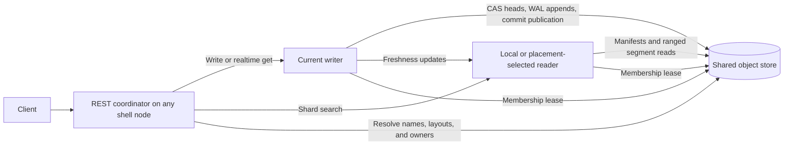

# Java serverless shell architecture

Each JVM can coordinate OpenSearch requests. Ingest-capable JVMs acquire writer ownership through object-store registers, and search-capable JVMs open readers where traffic lands. The object store is the durable coordination and data layer. Kubernetes can replace or reschedule the JVMs while the Java shell decides who owns, reads, and recovers each shard.

The source links pin the fork revision in the [research index](README.md). The [deployment contract](java-serverless-runtime.md) covers how the process is launched and reached.

## Assembly and ownership

| Layer | Control boundary |
| --- | --- |
| `:serverless:shell` | `ServerlessBootstrap` starts `ServerlessNode`. Node assembly constructs the local OpenSearch services, `NodeWiring` sets up REST and transport adapters, and the shell supplies its own routing, ownership, and recovery logic. |
| OpenSearch core | `IndicesService`, `IndexShard`, Lucene engines, `SearchService`, and response and query types are reused. `LocalViewProjector` gives core the index metadata and shard assignments needed by this JVM. The local `ClusterService` does not elect a deployment manager. |
| `MetadataPlane` | Provides descriptors, aliases, writer heads, membership, and other durable records through the store. `RegisterMap` identifies logical paths. A descriptor records index identity and routing layout. A head represents the owner and term, with predecessor log writers carried forward when necessary. |
| `:serverless:auth` | Optional REST authentication and identity propagation through plugin interfaces. Authorization and tenant isolation depend on the deployment's policy and configured filters. |
| `:serverless:testkit` | Exercises core seams, request and format behavior, and failure cases with in-process nodes, separate JVMs, and local object-store providers. |

[Bootstrap and lifecycle](https://github.com/huyz0/OpenSearch/blob/e71d42331a3ec82ec01109a5bb42d6a9a9162a5c/serverless/shell/src/main/java/org/opensearch/serverless/shell/ServerlessBootstrap.java) · [Node assembly](https://github.com/huyz0/OpenSearch/blob/e71d42331a3ec82ec01109a5bb42d6a9a9162a5c/serverless/shell/src/main/java/org/opensearch/serverless/node/NodeAssembly.java) · [Local view](https://github.com/huyz0/OpenSearch/blob/e71d42331a3ec82ec01109a5bb42d6a9a9162a5c/serverless/shell/src/main/java/org/opensearch/serverless/cluster/LocalViewProjector.java) · [Metadata plane](https://github.com/huyz0/OpenSearch/blob/e71d42331a3ec82ec01109a5bb42d6a9a9162a5c/serverless/shell/src/main/java/org/opensearch/serverless/metadata/MetadataPlane.java) · [Register paths](https://github.com/huyz0/OpenSearch/blob/e71d42331a3ec82ec01109a5bb42d6a9a9162a5c/serverless/shell/src/main/java/org/opensearch/serverless/metadata/RegisterMap.java) · [Auth implementation](https://github.com/huyz0/OpenSearch/blob/e71d42331a3ec82ec01109a5bb42d6a9a9162a5c/serverless/auth/src/main/java/org/opensearch/serverless/auth/ServerlessAuthPlugin.java)

Core hooks matter to the build boundary. The engine recovery snapshot hook and its `IndexShard` call site feed the object-store WAL into replay. Blob-store interfaces and provider implementations supply the conditional primitives. The pinned fork also carries shared mappings and tracing changes. Package from the intended fork revision with those hooks and dependencies present. The shell build checks that core does not import the shell, and the structure gate checks package dependencies and settings registration. [Fork architecture notes](https://github.com/huyz0/OpenSearch/blob/e71d42331a3ec82ec01109a5bb42d6a9a9162a5c/serverless/README.md) · [Engine snapshot hook](https://github.com/huyz0/OpenSearch/blob/e71d42331a3ec82ec01109a5bb42d6a9a9162a5c/server/src/main/java/org/opensearch/index/engine/Engine.java) · [Recovery call site](https://github.com/huyz0/OpenSearch/blob/e71d42331a3ec82ec01109a5bb42d6a9a9162a5c/server/src/main/java/org/opensearch/index/shard/IndexShard.java) · [Structure gate](https://github.com/huyz0/OpenSearch/blob/e71d42331a3ec82ec01109a5bb42d6a9a9162a5c/serverless/structure-rules.gradle)

## Membership and a writer acquisition

1. The node publishes its node ID, process incarnation, native transport address, roles, and load in an object-store lease. Renewals and refreshes run inside Java. The transport router uses the lease as its peer address book. The head's own expiry protects a newly acquired head long enough for membership observations to catch up.
2. A write coordinator resolves the index or alias to its descriptor and routes the document to a shard. A live owner gets the write through native forwarding. When there is no usable owner, the shell can request activation on an ingest node. The node checks that it can write, the index incarnation still exists, and the routing unit remains writable.
3. A new head uses conditional create. Taking an existing ordinary head uses CAS to advance the term. For a different owner in the same incarnation, acquisition respects the head's expiry floor and checks or revokes the previous lease before the swap. A losing contender reads the winning head and can route there. Small bucketed indices can share an ownership head, so a CR or Pod must never assume it owns a static partition of the index catalog.
4. The winner projects the local view and opens the shard. It uses the prior published commit and inherited log history as needed before serving as the new writer. The in-process activation queue limits concurrency and capacity. Idle release and optional hibernation are Java lifecycle decisions.

[Lease record](https://github.com/huyz0/OpenSearch/blob/e71d42331a3ec82ec01109a5bb42d6a9a9162a5c/serverless/shell/src/main/java/org/opensearch/serverless/membership/NodeLease.java) · [Writer activation](https://github.com/huyz0/OpenSearch/blob/e71d42331a3ec82ec01109a5bb42d6a9a9162a5c/serverless/shell/src/main/java/org/opensearch/serverless/node/WriterActivation.java#L221) · [Head acquisition](https://github.com/huyz0/OpenSearch/blob/e71d42331a3ec82ec01109a5bb42d6a9a9162a5c/serverless/shell/src/main/java/org/opensearch/serverless/metadata/ShardHeadStore.java#L219) · [Bucket ownership](https://github.com/huyz0/OpenSearch/blob/e71d42331a3ec82ec01109a5bb42d6a9a9162a5c/serverless/shell/src/main/java/org/opensearch/serverless/bucket/BucketHeads.java) · [Activation queue](https://github.com/huyz0/OpenSearch/blob/e71d42331a3ec82ec01109a5bb42d6a9a9162a5c/serverless/shell/src/main/java/org/opensearch/serverless/reconcile/ShardActivations.java)

## Write acknowledgement, publication, and recovery

`DocumentHandler` and `BulkDispatch` resolve and group writes. The receiving writer checks index incarnation and local ownership, then applies the operation so the engine can assign sequence identity and enforce conditional semantics. Before acknowledging, the writer checks its lease and term and commits the applied records to the per-node WAL. A node WAL window can batch records from multiple shards. Its default is **250 ms**, with 100, 200, and 250 ms accepted by bootstrap. This is a batching setting. It does not promise a response latency. [Document handler](https://github.com/huyz0/OpenSearch/blob/e71d42331a3ec82ec01109a5bb42d6a9a9162a5c/serverless/shell/src/main/java/org/opensearch/serverless/rest/DocumentHandler.java) · [Bulk dispatch](https://github.com/huyz0/OpenSearch/blob/e71d42331a3ec82ec01109a5bb42d6a9a9162a5c/serverless/shell/src/main/java/org/opensearch/serverless/documents/BulkDispatch.java) · [Append path](https://github.com/huyz0/OpenSearch/blob/e71d42331a3ec82ec01109a5bb42d6a9a9162a5c/serverless/shell/src/main/java/org/opensearch/serverless/node/NodeWritePath.java#L378) · [WAL settings](https://github.com/huyz0/OpenSearch/blob/e71d42331a3ec82ec01109a5bb42d6a9a9162a5c/serverless/shell/src/main/java/org/opensearch/serverless/nodelog/NodeLogSettings.java) · [WAL committer](https://github.com/huyz0/OpenSearch/blob/e71d42331a3ec82ec01109a5bb42d6a9a9162a5c/serverless/shell/src/main/java/org/opensearch/serverless/nodelog/NodeLogCommitter.java)

Acknowledgement and search visibility have different milestones. A conditional WAL append establishes durability. Tail push and the refresh paths can expose acknowledged changes before a segment publication. Publication records the covered state and makes persisted Lucene segments available to readers. Node packs are enabled by default, and the shell can stage logged commit information before checkpointing it. The Kubernetes acceptance test should measure write acknowledgement, realtime GET and search freshness separately. [Acknowledged tail path](https://github.com/huyz0/OpenSearch/blob/e71d42331a3ec82ec01109a5bb42d6a9a9162a5c/serverless/shell/src/main/java/org/opensearch/serverless/node/NodeWritePath.java#L410) · [Reader push](https://github.com/huyz0/OpenSearch/blob/e71d42331a3ec82ec01109a5bb42d6a9a9162a5c/serverless/shell/src/main/java/org/opensearch/serverless/node/ReaderPush.java) · [Commit staging](https://github.com/huyz0/OpenSearch/blob/e71d42331a3ec82ec01109a5bb42d6a9a9162a5c/serverless/shell/src/main/java/org/opensearch/serverless/store/CommitStaging.java) · [Node-pack wiring](https://github.com/huyz0/OpenSearch/blob/e71d42331a3ec82ec01109a5bb42d6a9a9162a5c/serverless/shell/src/main/java/org/opensearch/serverless/node/NodePackWiring.java)

A hard failure transfers ownership through the head and lease protocol. Takeover fences predecessor WAL epochs and replays required records past the published commit. The epoch fence competes for a WAL ordinal using conditional creation. A predecessor append that wins before the durable cutoff belongs to replay. A competing append cannot overwrite the fence. Local lease time bounds the write path, and the persistent fence closes the race between checking a lease and appending. An ambiguous client timeout can correspond to a durable record, so recovery tests classify acknowledged, definitively failed, and unknown outcomes separately. [Write fences](https://github.com/huyz0/OpenSearch/blob/e71d42331a3ec82ec01109a5bb42d6a9a9162a5c/serverless/shell/src/main/java/org/opensearch/serverless/node/WriteFences.java) · [WAL fence](https://github.com/huyz0/OpenSearch/blob/e71d42331a3ec82ec01109a5bb42d6a9a9162a5c/serverless/shell/src/main/java/org/opensearch/serverless/nodelog/NodeLogStore.java#L290) · [Takeover reader](https://github.com/huyz0/OpenSearch/blob/e71d42331a3ec82ec01109a5bb42d6a9a9162a5c/serverless/shell/src/main/java/org/opensearch/serverless/nodelog/NodeLogTakeover.java) · [Engine replay](https://github.com/huyz0/OpenSearch/blob/e71d42331a3ec82ec01109a5bb42d6a9a9162a5c/serverless/shell/src/main/java/org/opensearch/serverless/engine/ServerlessWriterEngine.java#L215) · [Fencing design](https://github.com/huyz0/OpenSearch/blob/e71d42331a3ec82ec01109a5bb42d6a9a9162a5c/serverless/rfc-fencing-closure.md)

The log is reclaimed using durable commit coverage, trim information, and pins. A required record that disappears from the store is a recovery failure. Replay uses a disposable local spool for its engine recovery snapshot, so a Pod with empty local state still needs enough writable disk for recovery. Keep live `nodelog/` objects outside age-based bucket expiry rules. The shell needs conditional store semantics even if Kubernetes restarts and rollouts are healthy. [Log writer and pins](https://github.com/huyz0/OpenSearch/blob/e71d42331a3ec82ec01109a5bb42d6a9a9162a5c/serverless/shell/src/main/java/org/opensearch/serverless/node/NodeLogWriter.java) · [Settlement](https://github.com/huyz0/OpenSearch/blob/e71d42331a3ec82ec01109a5bb42d6a9a9162a5c/serverless/shell/src/main/java/org/opensearch/serverless/metadata/ShardSettlement.java) · [Recovery spool](https://github.com/huyz0/OpenSearch/blob/e71d42331a3ec82ec01109a5bb42d6a9a9162a5c/serverless/README.md) · [Pilot durability checks](https://github.com/huyz0/OpenSearch/blob/e71d42331a3ec82ec01109a5bb42d6a9a9162a5c/serverless/pilot-readiness.md)

Kubernetes does not shorten recovery by assigning a replacement Pod the previous Pod's name. A graceful exit can publish, release its heads, and release its lease. An involuntary loss must wait for the applicable membership and ownership decisions, then acquire, fence, replay, and open. An open worker shortage, store backpressure, or a full survivor can stretch recovery beyond the nominal lease TTL. The branch has a dedicated takeover path and bounded activation overcommit. [Shutdown](https://github.com/huyz0/OpenSearch/blob/e71d42331a3ec82ec01109a5bb42d6a9a9162a5c/serverless/shell/src/main/java/org/opensearch/serverless/shell/ServerlessBootstrap.java#L407) · [Dead-node takeover](https://github.com/huyz0/OpenSearch/blob/e71d42331a3ec82ec01109a5bb42d6a9a9162a5c/serverless/shell/src/main/java/org/opensearch/serverless/reconcile/DeadNodeTakeover.java) · [Activation settings](https://github.com/huyz0/OpenSearch/blob/e71d42331a3ec82ec01109a5bb42d6a9a9162a5c/serverless/shell/src/main/java/org/opensearch/serverless/node/ActivationSettings.java)

## Reads, search placement, and API behavior

- **Realtime document reads.** GET resolves the document's shard and tries the owner so it can see acknowledged state before segment publication. The unowned-reader path handles published state and checks whether it can safely answer without ignoring newer WAL data. [Document reads](https://github.com/huyz0/OpenSearch/blob/e71d42331a3ec82ec01109a5bb42d6a9a9162a5c/serverless/shell/src/main/java/org/opensearch/serverless/ops/DocumentReads.java) · [Local reads](https://github.com/huyz0/OpenSearch/blob/e71d42331a3ec82ec01109a5bb42d6a9a9162a5c/serverless/shell/src/main/java/org/opensearch/serverless/node/NodeDocumentReads.java)
- **Search.** The planner resolves indices and shards, then searches in bounded fanout. It checks a usable local copy, tries up to two preferred readers using placement, heat and zone preferences, and falls back to the writer when appropriate. Capacity pressure can cause other readers to be tried. Cold readers open from published metadata and fetch missing segment ranges. Query and fetch responses are merged by the coordinator. [Search planner](https://github.com/huyz0/OpenSearch/blob/e71d42331a3ec82ec01109a5bb42d6a9a9162a5c/serverless/shell/src/main/java/org/opensearch/serverless/rest/SearchPlanner.java) · [Search fanout](https://github.com/huyz0/OpenSearch/blob/e71d42331a3ec82ec01109a5bb42d6a9a9162a5c/serverless/shell/src/main/java/org/opensearch/serverless/ops/SearchFanout.java) · [Shard selection](https://github.com/huyz0/OpenSearch/blob/e71d42331a3ec82ec01109a5bb42d6a9a9162a5c/serverless/shell/src/main/java/org/opensearch/serverless/ops/SearchShardCalls.java#L45) · [Block cache](https://github.com/huyz0/OpenSearch/blob/e71d42331a3ec82ec01109a5bb42d6a9a9162a5c/serverless/shell/src/main/java/org/opensearch/serverless/store/BlockCacheDirectory.java)
- **Partial results.** A search can report partial coverage with `complete: false` and shard failure information. Client tests need to check coverage, fresh results, and failure semantics across replacement. HTTP success alone cannot show that every shard answered. [Search handler](https://github.com/huyz0/OpenSearch/blob/e71d42331a3ec82ec01109a5bb42d6a9a9162a5c/serverless/shell/src/main/java/org/opensearch/serverless/rest/SearchHandler.java) · [Search rendering](https://github.com/huyz0/OpenSearch/blob/e71d42331a3ec82ec01109a5bb42d6a9a9162a5c/serverless/shell/src/main/java/org/opensearch/serverless/ops/SearchRendering.java)
- **Surface boundary.** The shell implements document APIs, search and PIT, named-index management, and snapshot routes with serverless semantics. Its refusal table includes classic cluster state, reindex, update by query, force merge, and scroll. Check plugins and clients against registered routes and semantic tests. A stock controller that assumes classic health, voting, or shard allocation remains incompatible. [Route registration](https://github.com/huyz0/OpenSearch/blob/e71d42331a3ec82ec01109a5bb42d6a9a9162a5c/serverless/shell/src/main/java/org/opensearch/serverless/shell/NodeWiring.java) · [Explicit refusals](https://github.com/huyz0/OpenSearch/blob/e71d42331a3ec82ec01109a5bb42d6a9a9162a5c/serverless/shell/src/main/java/org/opensearch/serverless/shell/RefusedEndpoints.java) · [REST spec coverage test](https://github.com/huyz0/OpenSearch/blob/e71d42331a3ec82ec01109a5bb42d6a9a9162a5c/serverless/testkit/src/test/java/org/opensearch/serverless/testkit/ServerlessSpecCoverageTests.java)

## Implications for the operator

Keep one source of truth for each responsibility. Kubernetes owns the Pods and Service endpoints. Java owns roles advertised to peers, shard ownership, and recovery. The store owns durable history. Test all three barriers when a Pod rolls or fails. A ready replacement may still be rebuilding caches or waiting to take a writer shard, and a cached read may still work while the writer side is recovering. The [operations study](java-serverless-operations.md) maps these behaviors to the checks and diagnostics a deployment needs.
