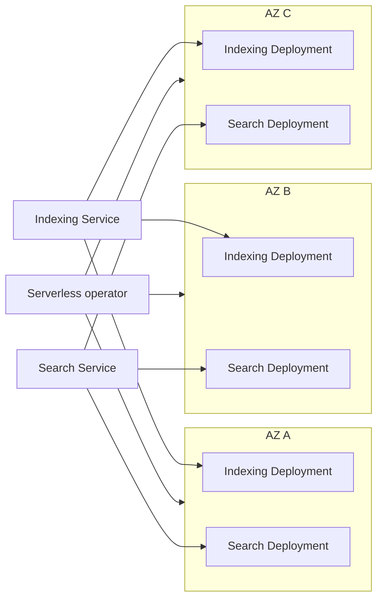

# Multi-AZ workloads for the Java serverless operator

A **Deployment per role and AZ** provides the reference design for group-level rollout control. For three zones and separate indexing and search pools, the operator would own six Deployments. Each Deployment can surge and replace Pods within its own zone. The operator can choose which role and zone advance and stop a planned rollout if observed availability falls below the configured floors. This fits the shell's object-store durability and keeps individual Pod replacement in Kubernetes. See the [StatefulSet and PostgreSQL comparison](multi-az-workload-research.md) for how this differs from the reference operators.

All Pods use the same deployment's object store. Indexing Pods run with `serverless.roles=ingest` and search Pods with `serverless.roles=search`. The Services select by role across zones. Native peer forwarding uses individual addresses from the Java leases. A zone is a failure domain for compute and routing. An index still has its durable data in the shared store.

## Placement contract

| Control | Proposed behavior |
| --- | --- |
| AZs and desired counts | Accept explicit zone names from `topology.kubernetes.io/zone` and explicit replicas per role and zone. For example, indexing may target `2/1/1` while search targets `1/2/2`. Per-zone zero is an intentional absence. Define minimum serving counts separately for each role and required zone. Add weighted or even allocation only if the API needs a role-wide total later. |
| Where Pods may land | Give each child an immutable deployment identity, role, and zone selector and enforce node affinity or a node selector for that exact zone. Intersect optional node-pool and hardware restrictions with the zone and surface conflicts. Apply hostname spread within a zone for host failure isolation. A hard one-Pod-per-host rule may need a spare host for surge. |
| JVM zone | Use the zonal workload's chosen zone as the launcher input and pass it as `-Dnode.attr.zone=<zone>` when using the default Java awareness attribute. The Pod can read an operator-owned zone label through the Downward API. Use the same value for Pod placement and launch configuration. Validate that the assigned Node's zone, the workload assignment, and the Java lease's zone agree. Kubernetes can also inject actual Node topology labels onto bound Pods with `PodTopologyLabelsAdmission` (beta and on by default starting in 1.35). Verify support if using that path. [Node topology labels](https://kubernetes.io/docs/reference/access-authn-authz/admission-controllers/#podtopologylabels) · [Downward API](https://kubernetes.io/docs/concepts/workloads/pods/downward-api/) · [Java zone lookup](https://github.com/huyz0/OpenSearch/blob/e71d42331a3ec82ec01109a5bb42d6a9a9162a5c/serverless/shell/src/main/java/org/opensearch/serverless/cluster/Zones.java#L69) |
| AZ unable to fit a Pod | Keep the intended assignment and show the shortfall. The remaining AZs need enough indexing, search, and object-store headroom for the selected failure target. An optional failover policy could raise survivor counts with explicit limits and a stability check before restoring the original placement. A fallback Pod should report the AZ in which it actually runs. See [one-AZ recovery](node-disruption-recovery.md#recover-from-the-loss-of-one-az). |
| Downscale and rebalancing | Choose the role and AZ to reduce, and check the resulting per-zone and total floors. Moving capacity between zones means bringing up the target capacity and verifying it before reducing the source. Keep one writer for each child Deployment's replica field. A future HPA could write a role-wide scale target that the operator distributes, or manage explicitly delegated zonal child counts. [HPA scale targets](https://kubernetes.io/docs/reference/kubernetes-api/autoscaling/horizontal-pod-autoscaler-v2/) |

## Rolling changes

1. **Stage the desired revision.** Track the desired image and configuration generation. Start with a canary pair of role and AZ. Prove old and new Java builds can share native transport and object-store formats before a mixed-version rollout.
2. **Check availability and surge budget.** Observe assigned, Ready, Available, terminating, and data-plane eligible Pods per role and AZ. Check the minimum serving count for every required role/AZ pair and the global concurrent-work budget before advancing a wave. Count changes already in flight. A conservative first policy is one role/AZ rollout at a time, with each child set to integer `maxUnavailable: 0` and `maxSurge: 1`. Parallel waves need an explicit global limit. The surge budget also needs room for Pods still consuming resources during termination.
3. **Advance one child template.** The Deployment creates a new ReplicaSet and starts its successor in the same AZ. Its own scale-down gate uses Pod availability, so build the essential application check into readiness so it affects replacement decisions. The Java route `/_serverless/ready` covers the JVM and search warm state. Valid own lease and correct peer reachability need their own verification. Pod probes should keep liveness independent of the shared store. Use `minReadySeconds` when availability needs to remain stable before old capacity is removed.
4. **Wait before advancing the next zone.** Verify the desired revision, expected availability, and role-specific checks. For search, measure fresh queries and cross-zone traffic after warm-up. For indexing, verify writes and acknowledged records after writer handover. Check drains and terminating Pods before releasing the rollout slot if the policy limits resource overlap. Back the controller's decisions with observed child revisions and status so it can resume after restart.
5. **Keep a blocked rollout visible.** A full AZ, a bad image, or a failed lease gate can block the successor. With a healthy baseline and `maxUnavailable: 0`, a stalled initial surge leaves old available Pods in place. Stop advancing other children, report the failing role and zone, and use the known-good template if rolling back. A Deployment progress deadline reports stalled progress and does not perform rollback. An AZ outage during an update can still lower observed availability.

[Kubernetes Deployment strategy, availability, and deadlines](https://kubernetes.io/docs/concepts/workloads/controllers/deployment/#strategy) · [Java readiness and lease signals](java-serverless-runtime.md)

A per-role, per-zone PDB can protect a floor on voluntary evictions. A floor of one with just one available Pod will block an ordinary eviction, so a node-drain workflow needs planned spare capacity or a deliberate degraded policy. Full AZ loss, direct deletion, and native rollout have their own semantics. Use Kubernetes workload ownership for normal replacement and the rollout policy for cross-zone coordination. [Pod disruption budgets](https://kubernetes.io/docs/concepts/workloads/pods/disruptions/#pod-disruption-budgets)

## What the Java shell already does with zones

| Path | Current behavior | Operator boundary |
| --- | --- | --- |
| Membership | `Zones.localZone` reads `node.attr.zone` by default, or `node.attr.<attribute>` for the first configured awareness attribute. `NodeLogStart` advertises it in the lease. Unknown origin and destination zones are tracked separately in transport stats. | Set and verify the runtime label. No per-Pod Node API credential is needed for a zone known from a hard-pinned template. [Zone lookup](https://github.com/huyz0/OpenSearch/blob/e71d42331a3ec82ec01109a5bb42d6a9a9162a5c/serverless/shell/src/main/java/org/opensearch/serverless/cluster/Zones.java) · [Lease publication](https://github.com/huyz0/OpenSearch/blob/e71d42331a3ec82ec01109a5bb42d6a9a9162a5c/serverless/shell/src/main/java/org/opensearch/serverless/node/NodeLogStart.java#L115) · [Traffic stats](https://github.com/huyz0/OpenSearch/blob/e71d42331a3ec82ec01109a5bb42d6a9a9162a5c/serverless/shell/src/main/java/org/opensearch/serverless/rest/StatsHandler.java#L490) |
| Indexing | The coordinator routes to the shard's current writer. Takeover first looks for an eligible survivor with capacity in the departed writer's zone, then expands to the fleet. The shard head's CAS determines ownership. | Zonal indexing counts make writer capacity and same-AZ takeover opportunities predictable. They give no per-index writer AZ assignment. A hard placement policy or an automatic move back to a preferred AZ after recovery would require a Java ownership and routing design. [Document routing](https://github.com/huyz0/OpenSearch/blob/e71d42331a3ec82ec01109a5bb42d6a9a9162a5c/serverless/shell/src/main/java/org/opensearch/serverless/ops/DocumentRouting.java) · [Takeover preference](https://github.com/huyz0/OpenSearch/blob/e71d42331a3ec82ec01109a5bb42d6a9a9162a5c/serverless/shell/src/main/java/org/opensearch/serverless/node/FleetPlacement.java#L183) · [Shard heads](https://github.com/huyz0/OpenSearch/blob/e71d42331a3ec82ec01109a5bb42d6a9a9162a5c/serverless/shell/src/main/java/org/opensearch/serverless/metadata/ShardHeadStore.java) |
| Search | Reader placement is cache affinity based on rendezvous hashing. For hot shards, Java prefers a reader in the coordinator's zone if it has capacity. The default threshold is one search per second from that coordinator, with an in-flight margin of eight before spilling to the fleet preference. Cold and overloaded shards can use other zones. | Create enough search capacity in intended client zones. Measure the whole request path because the coordinator's zone drives placement. Hard AZ isolation or a required number of readers per index or AZ would require Java changes. [Reader placement](https://github.com/huyz0/OpenSearch/blob/e71d42331a3ec82ec01109a5bb42d6a9a9162a5c/serverless/shell/src/main/java/org/opensearch/serverless/cluster/ReaderPlacement.java) · [Zone preference](https://github.com/huyz0/OpenSearch/blob/e71d42331a3ec82ec01109a5bb42d6a9a9162a5c/serverless/shell/src/main/java/org/opensearch/serverless/cluster/ZonePreference.java) · [Locality settings](https://github.com/huyz0/OpenSearch/blob/e71d42331a3ec82ec01109a5bb42d6a9a9162a5c/serverless/shell/src/main/java/org/opensearch/serverless/cluster/ReaderPlacementSettings.java) |
| Cache warm-up | Warm-on-join and search drain can smooth transitions. During warm copy, cross-zone block transfers are disabled by default and missing blocks may be read from the object store. Warm-up may finish by timeout. | Allow time and capacity for warm-up, track cold queries, and measure external store requests alongside peer bytes. Search drain does not drain the mixed node's writer role. [Warm-copy settings](https://github.com/huyz0/OpenSearch/blob/e71d42331a3ec82ec01109a5bb42d6a9a9162a5c/serverless/shell/src/main/java/org/opensearch/serverless/transport/WarmCopySettings.java#L61) · [Warm-up](https://github.com/huyz0/OpenSearch/blob/e71d42331a3ec82ec01109a5bb42d6a9a9162a5c/serverless/shell/src/main/java/org/opensearch/serverless/warm/SearchWarmup.java) · [Shutdown](https://github.com/huyz0/OpenSearch/blob/e71d42331a3ec82ec01109a5bb42d6a9a9162a5c/serverless/shell/src/main/java/org/opensearch/serverless/shell/ServerlessBootstrap.java#L407) |

Role-specific Services are useful because the shell can accept and forward requests at any role. Client routing is separate from placement. Optional `trafficDistribution: PreferSameZone`, where supported by the target Kubernetes dataplane, prefers a local Service endpoint and can fall back to other zones. It does not choose a shard writer or reader. Multi-zone clients behind a centralized ingress need an ingress-to-coordinator locality check as well. [Service traffic distribution](https://kubernetes.io/docs/reference/networking/virtual-ips/#traffic-distribution-control) · [Role split tests](https://github.com/huyz0/OpenSearch/blob/e71d42331a3ec82ec01109a5bb42d6a9a9162a5c/serverless/testkit/src/test/java/org/opensearch/serverless/testkit/NodeRoleSplitTests.java)

## When to own Pods directly

A single multi-AZ Deployment per role has fewer children and can spread scheduled Pods. Choose it only if best-effort distribution during replacement and downscale is acceptable. Separate zonal Deployments give a stronger availability boundary with native rollout progress and fit this requirement.

A CloudNativePG-style direct Pod controller is justified if testing shows the operator must pick the exact Pod, drain the application before any deletion, coordinate several prewarmed successors within one zone, or enforce a policy that depends on the individual instance. It would need idempotent Pod creation and deletion, ownership and recovery across operator restart, and checks that a successor has actually taken traffic. Design the direct option as a [reusable Pod lifecycle package](pod-lifecycle-package.md). Keep application-driven readiness, drain, and [blue/green promotion](blue-green-deployment.md) in the OpenSearch operator. [CloudNativePG custom controller](https://cloudnative-pg.io/docs/current/controller/)

## Verification that distinguishes the designs

| Scenario | Expected evidence |
| --- | --- |
| Three AZs with skewed targets | Every indexing and search Pod runs in its configured AZ and advertises that AZ in its lease. Check per-role counts even when the combined deployment looks balanced. |
| Roll one replica in an AZ | With spare capacity and a healthy baseline, keep that AZ's serving floor while the new Pod becomes available. Record old and new revisions, leases, endpoints, and serviceable counts through the transition. |
| No same-AZ surge capacity or a failed new image | The new Pod stays pending or unready, the healthy old baseline continues serving, and other AZs are not advanced by the policy. Verify the blocked status identifies the child and reason. |
| Zonal downscale, rebalance, and node drain | Remove the intended zone's excess only where floors allow it. In a rebalance, observe target capacity before source reduction. Check how the zonal PDB behaves with one Pod left. |
| Whole-AZ loss during rollout | Stop further planned disruption, measure write ownership recovery and search coverage, and verify permitted cross-zone fallback on survivors. Restore the zone and verify target counts. Record timeout and unknown write outcomes as well as acknowledged writes. |
| Search warm-up and forwarding | Measure local, cross-zone and unknown peer bytes by action, end-to-end query freshness and coverage, cache warm-up, and store traffic. Include a hot and cold index, a busy local zone, and clients behind the intended ingress. |

The Java testkit already contains locality, byte-metering, and same-zone takeover tests. These exercise Java behavior. A disposable Kubernetes cluster with three labelled zones and the selected object-store fixture is needed to verify scheduling and rolling behavior. [Zone preference tests](https://github.com/huyz0/OpenSearch/blob/e71d42331a3ec82ec01109a5bb42d6a9a9162a5c/serverless/testkit/src/test/java/org/opensearch/serverless/testkit/ZonePreferenceTests.java) · [Cache and takeover tests](https://github.com/huyz0/OpenSearch/blob/e71d42331a3ec82ec01109a5bb42d6a9a9162a5c/serverless/testkit/src/test/java/org/opensearch/serverless/testkit/ZoneLocalCopyTests.java) · [Traffic measurement test](https://github.com/huyz0/OpenSearch/blob/e71d42331a3ec82ec01109a5bb42d6a9a9162a5c/serverless/testkit/src/test/java/org/opensearch/serverless/testkit/ZoneCostMeterTests.java)
