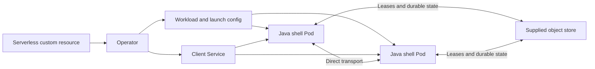

# Implications for a serverless operator

The upstream implementation gives us a model for managing Kubernetes objects and reporting progress. A Java serverless operator needs its own workload lifecycle because membership, shard ownership, and recovery belong to the Java shell and its object store. The options below are research findings. They leave the CRD, implementation language, and deployment policy open for the next phase.

## Reuse boundaries

| Area | Reuse from upstream | Work specific to Java serverless |
| --- | --- | --- |
| Manager | Scheme registration, namespaced watching, controller readiness, optional leader election, explicit concurrency | One serverless reconciler can start with the permissions required by its actual children. Operator leader election is independent of Java membership. |
| API | Typed spec, schema validation, status subresource, observed generation, standard conditions | Define the image and launch settings, replica count and roles, resources, referenced store and credentials, and supported security inputs. Validate role and store combinations. Keep CRD kind, group, and version open. |
| Desired state | Pure builders, deterministic names and selectors, owner references, conflict-safe writes, owned-resource watches | Build a Java-shell workload and client Service. Produce the shell settings and mount its local work, credential, and TLS paths. Define how changes to referenced configuration cause a restart. |
| Notifications and status | Observe updates and availability, report reasons and events, and distinguish temporary failure from invalid desired state | Use the shell's startup and search-readiness signals, then validate lease and native peer reachability independently. Attribute any fleet check to the nodes it observed. The upstream global allocation health signal has different semantics. |
| Lifecycle | Explicit rollout gates, one owner for the replica field, and resumable orchestration where needed | Kubernetes controls replicas and Pod replacement. The Java shell handles ownership transfer and takes over expired shards. Evaluate the shell's existing search drain and verify the JVM writer handover and failure behavior before adding controller-driven drain. |
| Storage | Document what gets retained and who owns it | Use an explicitly supplied shared store as the durability boundary. Treat the store identity as an immutable binding in an initial design. Changing it needs a migration or cutover contract. Deleting a CR should preserve the user-provided bucket and its contents. |
| Release and tests | Generated manifests, separate installation and instance configuration, pure builders, envtest, and real-cluster tests | Pin the Java OCI image, test the launcher and network contract, and exercise lease and replay behavior against the chosen local S3-compatible fixture. |

See the [upstream source walkthrough](upstream-operator.md) and [Java deployment contract](java-serverless-runtime.md) for the evidence behind this mapping.

## Implementation options

| Option | Fits when | Main cost |
| --- | --- | --- |
| Standalone controller using upstream patterns | The API and lifecycle are specific to serverless and need to coexist with stock OpenSearch deployments | Own a small manager, CRD, and release process. This is the strongest fit from the current source study. |
| Fork upstream and replace the workload paths | Reusing existing chart or CR integration is a hard requirement | Replace the builder, bootstrap, lifecycle controllers, health gates, and plugin-specific behavior. Keep reconciling upstream changes across those seams. |
| Add a serverless mode to upstream | Upstream maintainers want to own a second runtime contract and the compatibility rules are agreed | A shared spec gains two sets of validation and lifecycle rules. Both modes and migration between API versions need regression coverage. |

Setting only `spec.general.image` would still execute the classic builders and reconciliation chain. A compatibility layer that fakes voting or allocation would hide real serverless state from the controller. A standalone Go controller using controller-runtime is a candidate because its primitives match the Kubernetes work here and the Java process has a separate image boundary. The user can choose a different language or integration model without changing the runtime requirements.

## First deployment shape to evaluate

The controller can reconcile one mixed `ingest,search` workload, one client ClusterIP Service, and the configuration the launcher consumes for each namespaced custom resource. Keep the object store and its credentials externally supplied. Grant write access to resources the controller manages, and define the watch strategy for referenced Secrets and ConfigMaps separately from watches on owned children. An initial rollout can use Kubernetes' workload controller. Test the shell's readiness and local lease signals, and measure the grace period needed for search drain and writer shutdown under load.

Evaluate a Deployment with bounded `emptyDir` for replaceable local state. It gives the application fresh Pods and allows a surge before taking old Pods out of service. If recovery with fresh local state fails, or persistent identity or cache retention is needed, evaluate a StatefulSet and explicitly define what stays on disk and how replacement recovers. For explicit AZ counts and zonal rollout floors, use the [multi-AZ workload proposal](multi-az-operator-design.md). A PodDisruptionBudget can limit voluntary evictions such as a node drain. The workload's own rollout settings govern controller-initiated rolling updates. For a Deployment, size surge and unavailable capacity for the selected replica counts and test that upgrades can progress with resource quotas and placement constraints. [Deployments](https://kubernetes.io/docs/concepts/workloads/controllers/deployment/) · [StatefulSets](https://kubernetes.io/docs/concepts/workloads/controllers/statefulset/) · [Pod disruptions](https://kubernetes.io/docs/concepts/workloads/pods/disruptions/)

The operator's status can report desired, available, and updated replicas and the latest observed generation. If it also reports runtime membership, correlate observations to the Pod or node ID and timestamp. Keep the Java data path independent of controller availability. A finalizer would be justified by cleanup the API server cannot perform through ownership, such as an explicitly managed external resource. With an externally supplied store and ordinary Kubernetes children, avoiding that cleanup dependency simplifies deletion during an outage.

Explicit node pools, autoscaling, Dashboards, certificate issuance, managed buckets, and OpenSearch application-resource CRDs are separate choices. Before adding a controller for any of them, identify the Java API or Kubernetes signal it depends on. Replica policies need to preserve ingest and search capacity, and a mixed-version rollout needs transport and on-store format compatibility for the selected source and target images.

## Evidence needed to move from research to implementation

| Order | Check | Evidence that resolves it |
| --- | --- | --- |
| 1 | Establish the image and launcher contract | A pinned Java image starts as a non-root user using production dependencies, explicit writable paths and JVM settings, and the selected credentials. The JVM receives Pod termination signals. |
| 2 | Verify peer addressing and traffic eligibility | Two Pods on the same fixture bucket publish different reachable peer addresses and forward a request across Pods. Independent instances use different buckets and cannot see each other's data. Missing credentials or failed lease publication leave a new Pod ineligible for traffic. A recovered Pod can become ready without a restart loop during a shared-store outage. |
| 3 | Verify replacement, scale-down, and retention | Write with explicit IDs, record acknowledged writes, and keep reading and writing through a graceful deletion and a hard kill. Check handover and lease-expiry takeover separately. Replace the fleet with fresh local directories and verify acknowledged documents. Delete and recreate the CR against the same store and check retention. Capture recovery time and failed or unknown outcomes. |
| 4 | Verify controller convergence | Test generated workloads, network settings, and selectors. Use envtest for creation, drift repair, status, reference or config changes, and ownership. Use a disposable Kubernetes cluster for signal delivery, rolling replacement, network policy, and data recovery. |
| 5 | Qualify an image change | Prove the selected old and new builds can share transport and the object store during rollout. Test a failed new Pod and rollback on an already populated bucket before defining an upgrade policy. |

The published Java branch already includes `processTest`, `fleetTest`, and a RustFS gate. Those suites supply examples for counting acknowledged writes and reporting recovery outcomes. The [operations study](java-serverless-operations.md) maps the fixtures and their limits to the Kubernetes checks. [Pilot readiness](https://github.com/huyz0/OpenSearch/blob/e71d42331a3ec82ec01109a5bb42d6a9a9162a5c/serverless/pilot-readiness.md)
