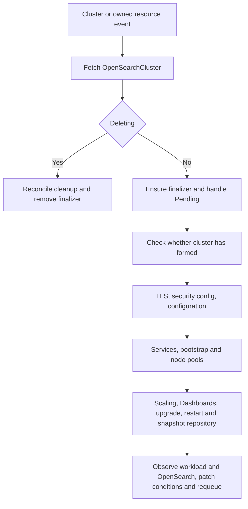

# Upstream OpenSearch Kubernetes Operator

The upstream controller is a Go manager using controller-runtime. Its input is a namespaced `opensearch.org/v1` `OpenSearchCluster`. It translates desired state into Kubernetes objects, then calls OpenSearch APIs to coordinate changes that Kubernetes cannot make safely on its own.

## Manager and API

- `main.go` registers Kubernetes, current and legacy OpenSearch, and monitoring types. It configures the manager's namespace cache, reconciliation concurrency, optional webhook server, and leader election. The Helm Deployment passes `--leader-elect`; the binary's default is off. The manager's `/healthz` and `/readyz` use controller-runtime ping checks and describe the controller process. [Manager](https://github.com/opensearch-project/opensearch-k8s-operator/blob/b0be10474334e676c6044e7943322685af2e2d34/opensearch-operator/main.go) · [Helm Deployment](https://github.com/opensearch-project/opensearch-k8s-operator/blob/b0be10474334e676c6044e7943322685af2e2d34/charts/opensearch-operator/templates/deployment.yaml)
- The cluster spec combines general settings, node pools, bootstrap, Dashboards, and security. Each node pool has a component name, replica count, roles, and workload and storage settings. Status has a dedicated subresource with phase, initialization, version, component progress, observations, and Kubernetes conditions. The admission webhook validates creates and updates, including storage-class and TLS changes. [Cluster API types](https://github.com/opensearch-project/opensearch-k8s-operator/blob/b0be10474334e676c6044e7943322685af2e2d34/opensearch-operator/api/opensearch.org/v1/opensearch_types.go) · [Cluster validator](https://github.com/opensearch-project/opensearch-k8s-operator/blob/b0be10474334e676c6044e7943322685af2e2d34/opensearch-operator/webhook/opensearch_cluster_webhook.go)
- The legacy `opensearch.opster.io/v1` API has a separate migration controller. It creates or synchronizes corresponding current-group resources, mirrors status, and handles ownership transitions such as certificate Secrets. Other controllers manage OpenSearch users, roles, role bindings, tenants, action groups, ISM, snapshot policies, and templates through application APIs. These features enlarge the API and RBAC surface independently of cluster provisioning. [Migration controller](https://github.com/opensearch-project/opensearch-k8s-operator/blob/b0be10474334e676c6044e7943322685af2e2d34/opensearch-operator/controllers/migration_controller.go) · [Controller registrations](https://github.com/opensearch-project/opensearch-k8s-operator/blob/b0be10474334e676c6044e7943322685af2e2d34/opensearch-operator/main.go#L249)

## Reconcile loop

`OpenSearchClusterReconciler` watches the current CR and directly owned Pods, Secrets, ConfigMaps, Services, Deployments, StatefulSets, PVCs, and NetworkPolicies. It keeps request state local for concurrent reconciles. The `Opensearch` finalizer uses an optimistic-lock metadata patch with conflict retries. `Pending` transitions to `Running` early and checks for retained manager PVCs before creating resources. For a new cluster, `Initialized` separately requires manager Pods to be ready and joined according to the OpenSearch API. [Cluster controller](https://github.com/opensearch-project/opensearch-k8s-operator/blob/b0be10474334e676c6044e7943322685af2e2d34/opensearch-operator/controllers/opensearchController.go) · [Cluster API observations](https://github.com/opensearch-project/opensearch-k8s-operator/blob/b0be10474334e676c6044e7943322685af2e2d34/opensearch-operator/pkg/reconcilers/util/util.go#L462)

A running pass calls TLS → security configuration → configuration → cluster → scaler → Dashboards → upgrade → rolling restart → snapshot repository. A retryable error or an explicit `Requeue` stops the pass. A terminal error is captured for status while later components can run. A delay-only requeue lets the chain continue and can shorten its 30-second fallback interval. This is how scaler and rollout workflows avoid racing ordinary reconciliation. Status combines Kubernetes readiness and revision observations with application health. `Ready`, `Progressing`, and `Degraded` carry generation and reasons. Red application health sets `Degraded`, while the readiness gate uses health availability, workload progress, and Pod readiness. The three-pass transient failure threshold uses an in-memory counter. [Reconcile chain](https://github.com/opensearch-project/opensearch-k8s-operator/blob/b0be10474334e676c6044e7943322685af2e2d34/opensearch-operator/controllers/opensearchController.go#L367) · [Condition derivation](https://github.com/opensearch-project/opensearch-k8s-operator/blob/b0be10474334e676c6044e7943322685af2e2d34/opensearch-operator/pkg/reconcilers/conditions.go)

## Workloads and the OpenSearch lifecycle

| Path | Behavior in the pinned code |
| --- | --- |
| Configuration | Writes shared and optional per-pool `opensearch.yml` ConfigMaps, assembles volumes and mounts from TLS and security configuration, and calculates per-pool configuration hashes for the StatefulSet Pod template. [Configuration reconciler](https://github.com/opensearch-project/opensearch-k8s-operator/blob/b0be10474334e676c6044e7943322685af2e2d34/opensearch-operator/pkg/reconcilers/configuration.go) |
| Bootstrap and discovery | Creates the HTTP Service and a discovery Service that publishes unready addresses. A temporary bootstrap Pod and PVC support classic cluster formation. The Pod's deliberately failing readiness probe keeps it out of normal client traffic. Once initialized, the reconciler excludes the bootstrap Pod from voting before removal. Retained manager PVCs can bypass the bootstrap path. [Resource reconciliation](https://github.com/opensearch-project/opensearch-k8s-operator/blob/b0be10474334e676c6044e7943322685af2e2d34/opensearch-operator/pkg/reconcilers/cluster.go#L158) · [Workload builders](https://github.com/opensearch-project/opensearch-k8s-operator/blob/b0be10474334e676c6044e7943322685af2e2d34/opensearch-operator/pkg/builders/cluster.go) |
| Node pools | Creates a headless Service and a StatefulSet per component. The StatefulSet combines parallel pod management, the `OnDelete` update strategy, stock entrypoint and environment settings, and PVCs by default. Startup and readiness default to an exec probe against the HTTP root. Liveness checks the HTTP TCP port. The cluster reconciler preserves the live replica count after creation so the scaler can own changes. [StatefulSet builder](https://github.com/opensearch-project/opensearch-k8s-operator/blob/b0be10474334e676c6044e7943322685af2e2d34/opensearch-operator/pkg/builders/cluster.go#L298) · [Node pool reconciliation](https://github.com/opensearch-project/opensearch-k8s-operator/blob/b0be10474334e676c6044e7943322685af2e2d34/opensearch-operator/pkg/reconcilers/cluster.go#L235) |
| Scale and remove | Changes replicas in steps. Manager removal uses voting-config exclusions. Smart data-node removal adds allocation exclusions and checks drain progress before reducing replicas. The scaler records the target and drain progress, cleans up exclusions, and also handles removed pools. [Scaler](https://github.com/opensearch-project/opensearch-k8s-operator/blob/b0be10474334e676c6044e7943322685af2e2d34/opensearch-operator/pkg/reconcilers/scaler.go) |
| Restart and upgrade | The restart reconciler sees a StatefulSet revision mismatch, selects a Pod, checks readiness and classic quorum and allocation constraints, and deletes the Pod so Kubernetes replaces it. The upgrade reconciler validates versions, records a target and pool progress, coordinates the version change, and restores shard allocation as appropriate. The gateway implements these checks through classic OpenSearch APIs. [Rolling restart](https://github.com/opensearch-project/opensearch-k8s-operator/blob/b0be10474334e676c6044e7943322685af2e2d34/opensearch-operator/pkg/reconcilers/rollingRestart.go) · [Upgrade](https://github.com/opensearch-project/opensearch-k8s-operator/blob/b0be10474334e676c6044e7943322685af2e2d34/opensearch-operator/pkg/reconcilers/upgrade.go) · [Gateway](https://github.com/opensearch-project/opensearch-k8s-operator/blob/b0be10474334e676c6044e7943322685af2e2d34/opensearch-operator/opensearch-gateway/services/os_data_service.go#L325) |
| Security and network | TLS reconciliation prepares generated or referenced certificates and mounts. Security configuration uses a `securityadmin.sh` Job when supported and can otherwise mount generated configuration for Security plugin default initialization. The optional upstream NetworkPolicy is ingress-only and permits traffic from selected cluster, Dashboards, security job, and operator peers, plus configured exceptions. [TLS reconciler](https://github.com/opensearch-project/opensearch-k8s-operator/blob/b0be10474334e676c6044e7943322685af2e2d34/opensearch-operator/pkg/reconcilers/tls.go) · [Security configuration](https://github.com/opensearch-project/opensearch-k8s-operator/blob/b0be10474334e676c6044e7943322685af2e2d34/opensearch-operator/pkg/reconcilers/securityconfig.go) · [NetworkPolicy builder](https://github.com/opensearch-project/opensearch-k8s-operator/blob/b0be10474334e676c6044e7943322685af2e2d34/opensearch-operator/pkg/builders/cluster.go#L1822) |
| Ownership and deletion | Child builders are paired with controller references and a generic create/patch/delete layer. Its normal update path calculates a patch from desired, live, and last-applied state. The finalizer runs component cleanup, including removal of the cluster-scoped binding used for optional node attributes. Persistent data behavior depends on PVC retention and storage policy. [Resource reconciler](https://github.com/opensearch-project/opensearch-k8s-operator/blob/b0be10474334e676c6044e7943322685af2e2d34/opensearch-operator/pkg/reconciler/resource.go) · [Delete path](https://github.com/opensearch-project/opensearch-k8s-operator/blob/b0be10474334e676c6044e7943322685af2e2d34/opensearch-operator/controllers/opensearchController.go#L197) |

## Packaging and tests

The operator and cluster ship as separate Helm charts. The operator chart installs the manager Deployment, service account, RBAC, and optional CRD and webhook resources. The cluster chart renders the custom resource. The Makefile uses controller-gen for CRD, RBAC, webhook, and API object generation. The manager also has a Kustomize and OLM packaging path. [Operator chart](https://github.com/opensearch-project/opensearch-k8s-operator/tree/b0be10474334e676c6044e7943322685af2e2d34/charts/opensearch-operator) · [Cluster chart](https://github.com/opensearch-project/opensearch-k8s-operator/tree/b0be10474334e676c6044e7943322685af2e2d34/charts/opensearch-cluster) · [Makefile](https://github.com/opensearch-project/opensearch-k8s-operator/blob/b0be10474334e676c6044e7943322685af2e2d34/opensearch-operator/Makefile)

Builder and reconciler tests exercise desired resource shapes and branch behavior. The controller suite starts an API server and etcd through envtest, runs the manager, and supplies mocked OpenSearch HTTP responses. Functional tests create a k3d cluster, install both charts, and cover paths such as scale, upgrades, migration, and data integrity. This division is useful for the serverless operator, where only a real multi-Pod test can exercise transport, leases, object-store recovery, and Kubernetes termination together. [Controller suite](https://github.com/opensearch-project/opensearch-k8s-operator/blob/b0be10474334e676c6044e7943322685af2e2d34/opensearch-operator/controllers/suite_test.go) · [Functional tests](https://github.com/opensearch-project/opensearch-k8s-operator/tree/b0be10474334e676c6044e7943322685af2e2d34/opensearch-operator/functionaltests)
